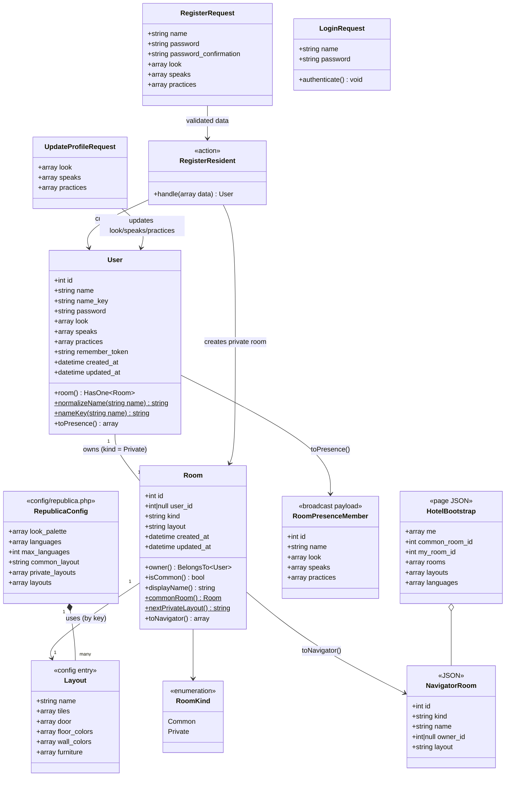

# República — Entrega 1: moradores, quartos, Sala de estar, navegador e movimento em tempo real

## Requirements

- Criar a base jogável da República: permitir que um grupo de amigos crie sua conta de morador, ganhe um quarto próprio, entre pela Sala de estar comum, navegue entre os quartos e ande por eles vendo os outros moradores em tempo real, no visual isométrico retrô em tons pastel laranja e verde.
- Identificar o morador por **nome único (sem distinção de maiúsculas/minúsculas) + senha**, com **aparência de avatar** e **idiomas que fala / quer praticar** escolhidos no cadastro e editáveis depois.
- Garantir que **cada morador tenha exatamente um quarto**, criado na mesma operação do cadastro, com planta fixa e não editável.
- Tornar a república **viva e encontrável**: todo login começa na Sala de estar; o navegador mostra a Sala de estar no topo e os quartos ocupados primeiro, com contagem de pessoas e os idiomas de quem está lá.
- Manter **um morador em um só lugar**: uma nova aba assume a sessão e a antiga é desconectada com aviso.
- Limites: fora do escopo desta entrega — conversa por voz, pedidos de call, indicadores de fala (entrega 2) e amizades, mensagens, lista de amigos e "Ir até" (entrega 3). Não há chat de texto nos quartos. Funciona apenas em navegador de computador.

## Entities

Notas do modelo:
- **Sala de estar** é um `Room` com `kind = common` e `user_id = null`, criado pela própria migration (sempre existe exatamente uma).
- **Plantas** (layouts), **paleta do avatar** e **lista de idiomas** vivem em `config/republica.php` (fonte única); o servidor valida contra ela e a página do jogo a recebe em JSON. Nenhuma planta é guardada no banco — o `Room` guarda apenas a chave.
- **Presença, posição e movimento** não são entidades persistidas: existem apenas nos canais de presença do Reverb e nos clientes conectados.

## Approach

1. **Identidade e cadastro (Laravel monolítico, Blade)**:
   - Substituir o esquema base de usuários (e-mail) por **nome de exibição + `name_key` normalizado** (minúsculas, espaços aparados e colapsados) com índice único — unicidade sem distinção de caixa e portável entre SQLite (local) e o banco do Laravel Cloud.
   - Login por nome usando `Auth::attempt(['name_key' => ..., 'password' => ...])`, com **limite de tentativas** (RateLimiter, 5 por minuto por nome+IP).
   - Cadastro executado por uma **Action** (`RegisterResident`) dentro de **transação**: cria o morador e o quarto privado com a próxima planta da rotação; falha em qualquer parte desfaz tudo.
   - Perfil editável (aparência e idiomas) em página própria; o nome não é editável.

2. **Catálogo fixo como fonte única (config)**:
   - `config/republica.php` define paleta do avatar (4 partes × 6 cores pastel), 10 idiomas (código, nome em português, cores da mini-bandeira), plantas (piso em grade de caracteres, porta, cores, móveis) e a rotação das plantas privadas.
   - Validação do servidor e renderização do cliente usam o mesmo catálogo: o servidor injeta o catálogo no JSON da página do jogo e nas telas de cadastro/perfil.

3. **Tempo real com Reverb (sem estado no servidor)**:
   - **Canal de presença global `republica`**: todos os moradores online; cada cliente anuncia por whisper `where` em qual quarto está — alimenta a ocupação do navegador e os idiomas por quarto. Também carrega o whisper `takeover` para a regra "a aba nova assume".
   - **Canal de presença por quarto `quarto.{room}`**: quem está no quarto; posições e movimentos trafegam por whispers (`move`, `state`). O servidor apenas autoriza a entrada (morador autenticado + quarto existente) e devolve os dados públicos do membro.
   - **Movimento decidido no cliente**: ao clicar num ponto do piso, o cliente calcula o caminho localmente, anuncia apenas `{from, to}` e os demais recalculam o mesmo caminho com o mesmo algoritmo determinístico (BFS 8 direções, sem cortar quinas, ordem fixa de vizinhos) sobre a mesma planta — tráfego mínimo, sem laço de jogo no PHP.
   - Sincronização de quem chega: ao receber `joining`, cada presente envia `state` com sua posição atual; quem chega começa na porta (ou no ponto livre mais próximo dela).

4. **Cliente do jogo (JS modular puro + Canvas, empacotado pelo Vite)**:
   - Projeção isométrica 2:1 (tile 64×32), desenho procedural de piso, paredes, móveis e avatares (pixel art em retângulos, sem assets), ordenação por profundidade `x + y`, animação a 60 fps com `requestAnimationFrame`, velocidade de 2,5 tiles/s.
   - Interface retrô (janelas com barra de título, botões biselados) com tokens de cor pastel via Tailwind `@theme` + CSS de componentes; fonte Verdana/Tahoma em negrito como as interfaces da época.
   - Bloqueio amigável em celular: em telas sem ponteiro fino e com largura < 900 px, a página mostra o aviso "A República funciona no computador" em vez do jogo.

5. **Regras de negócio e erros**:
   - Validação por **Form Requests**; erros de formulário voltam à página com mensagens em português (fluxo padrão do Laravel — o equivalente ao "GlobalExceptionHandler" é o handler de exceções do framework em `bootstrap/app.php`, que já converte `ValidationException` em redirect com erros ou JSON 422).
   - Autorização de canais retorna `false`/404 para quarto inexistente ou usuário não autenticado; endpoints JSON retornam 401 para visitantes.
   - Regras de presença (um lugar por vez, não parar em ponto ocupado, porta livre) são aplicadas no cliente, pois o estado de posição é efêmero e só existe nos clientes.

## Structure

### Inheritance Relationships
1. `App\Models\User` extends `Illuminate\Foundation\Auth\User` (Authenticatable).
2. `App\Models\Room` extends `Illuminate\Database\Eloquent\Model`.
3. `App\Enums\RoomKind` é um enum `string` (`common`, `private`).
4. `App\Http\Requests\RegisterRequest`, `LoginRequest`, `UpdateProfileRequest` extends `Illuminate\Foundation\Http\FormRequest`.
5. Controllers em `App\Http\Controllers` extends `App\Http\Controllers\Controller`.
6. `Database\Factories\UserFactory` extends `Factory<User>`; `Database\Factories\RoomFactory` extends `Factory<Room>`.
7. Testes de feature extends `Tests\TestCase` com `RefreshDatabase`.

### Dependencies
1. `RegisterController@store` usa `RegisterRequest` e chama `RegisterResident::handle()`, depois `Auth::login()`.
2. `RegisterResident` depende de `User`, `Room::nextPrivateLayout()` e `DB::transaction()`.
3. `LoginController@store` usa `LoginRequest::authenticate()` (que usa `Auth::attempt`, `RateLimiter`, `User::nameKey()`).
4. `ProfileController` usa `UpdateProfileRequest` e o usuário autenticado.
5. `HotelController@show` usa `Room` (lista para o navegador, Sala de estar, quarto do usuário) e `config('republica')`.
6. `RoomController@index` e `HotelController@show` usam `RoomController::navigatorRooms()`, que usa `Room::toNavigator()`.
7. `routes/channels.php` usa `User::toPresence()` e o route-model-binding de `Room`.
8. Front-end: `resources/js/hotel.js` → `republica/game.js` → (`iso.js`, `renderer.js`, `avatar.js`, `pathfinding.js`, `room-session.js`, `republic-presence.js`, `navigator.js`, `avatar-card.js`, `ui.js`); `room-session.js` e `republic-presence.js` usam `window.Echo` (`resources/js/echo.js`).
9. `resources/js/profile-form.js` → `republica/avatar.js` (pré-visualização) — usado em cadastro e perfil.

### Layered Architecture
1. **Rotas**: `routes/web.php` (páginas e JSON), `routes/channels.php` (autorização de canais de presença).
2. **HTTP (Controllers + Form Requests)**: recebem a requisição, validam contra o catálogo, delegam e escolhem a resposta (view, redirect, JSON).
3. **Domínio (Action + Models)**: `RegisterResident` orquestra o cadastro atômico; `User` e `Room` concentram normalização de nome, rotação de plantas e serialização para presença/navegador.
4. **Persistência**: Eloquent + migrations (`users`, `rooms`); Sala de estar inserida pela migration.
5. **Configuração**: `config/republica.php` — catálogo imutável (paleta, idiomas, plantas).
6. **Tempo real**: Reverb (canais `presence-republica`, `presence-quarto.{id}`) + whispers do cliente.
7. **Apresentação**: Blade (layout, login, cadastro, perfil, hotel) + cliente Canvas em `resources/js/republica/`.
8. **Tratamento de erros**: handler padrão do Laravel (`bootstrap/app.php`) — validação → redirect com erros / 422 JSON; não autenticado → redirect para `/entrar` ou 401 JSON.

## Operations

### 1. Update Migration - `database/migrations/0001_01_01_000000_create_users_table.php`
1. Responsibility: esquema do morador (sem dados em produção, o esquema base é alterado diretamente).
2. Attributes (tabela `users`):
   - `id`: bigint PK
   - `name`: string(16) — nome de exibição como digitado (normalizado em espaços)
   - `name_key`: string(16), **unique** — `mb_strtolower` do nome normalizado; usado para unicidade e login
   - `password`: string
   - `look`: json — `{skin, hair, shirt, pants}` (hex do catálogo)
   - `speaks`: json — lista de códigos de idioma
   - `practices`: json — lista de códigos de idioma
   - `remember_token`, `timestamps`
3. Remover `email`, `email_verified_at` e a tabela `password_reset_tokens` (não há recuperação por e-mail). Manter a tabela `sessions` como está.
4. Constraints: `name_key` único; nenhum campo de e-mail.

### 2. Create Migration - `database/migrations/0001_01_01_000003_create_rooms_table.php`
1. Responsibility: quartos privados e a Sala de estar.
2. Attributes (tabela `rooms`):
   - `id`: bigint PK
   - `user_id`: foreignId nullable, **unique**, `constrained()->cascadeOnDelete()`
   - `kind`: string(16) — `common` | `private`
   - `layout`: string(32) — chave de `config('republica.layouts')`
   - `timestamps`
3. `up()`: após criar a tabela, inserir a Sala de estar: `kind = 'common'`, `user_id = null`, `layout = config('republica.common_layout')`, timestamps atuais.
4. Constraints: exatamente uma linha `common`; quartos `private` sempre com `user_id`.

### 3. Create Config - `config/republica.php`
1. Responsibility: catálogo imutável e fonte única para servidor e cliente.
2. Chaves:
   - `look_palette`: `skin` = `#ffe0c4, #f3c79e, #dba77a, #b9805a, #8a5a3c, #5e3c28`; `hair` = `#2e211b, #6b4a3a, #a8643f, #e3b766, #d9694a, #f6ead8`; `shirt` = `#e8735a, #f4b393, #9fbf9a, #5f8f86, #f2d16b, #f6ead8`; `pants` = `#6b4a3a, #3e3431, #5f8f86, #c9a27e, #8d5b4c, #e8735a`.
   - `default_look`: `{skin: #f3c79e, hair: #6b4a3a, shirt: #e8735a, pants: #6b4a3a}`.
   - `languages`: mapa código → `{name, flag}` onde `flag` são 2–3 cores em faixas para a mini-bandeira: `pt` Português `[#009c3b, #ffdf00]`, `en` Inglês `[#012169, #ffffff, #c8102e]`, `es` Espanhol `[#aa151b, #f1bf00, #aa151b]`, `fr` Francês `[#0055a4, #ffffff, #ef4135]`, `de` Alemão `[#000000, #dd0000, #ffce00]`, `it` Italiano `[#009246, #ffffff, #ce2b37]`, `ja` Japonês `[#ffffff, #bc002d, #ffffff]`, `ko` Coreano `[#ffffff, #003478, #c60c30]`, `zh` Chinês `[#de2910, #ffde00, #de2910]`, `ru` Russo `[#ffffff, #0039a6, #d52b1e]`.
   - `max_languages`: `3` (por lista).
   - `common_layout`: `'sala-de-estar'`.
   - `private_layouts`: `['sala', 'jardim', 'por-do-sol', 'estudio']` (ordem da rotação).
   - `layouts`: mapa chave → `{name, tiles, door, floor, wall_left, wall_right, furniture}`:
     - `tiles`: array de strings (linhas); `.` = piso, `x` = vazio. Quartos privados 10×10 (com um recorte `x` diferente em cada planta para variar a forma); `sala-de-estar` 16×14.
     - `door`: `[x, y]` — tile de chegada, sempre um piso na borda esquerda (`x = 0`), onde a parede ganha a abertura da porta.
     - `floor`, `wall_left`, `wall_right`: cores pastel (ex.: `sala` piso `#e9cfae`, paredes `#f4b393`/`#e09a76`; `jardim` piso `#cfd9bf`, paredes `#c6dcc0`/`#9fbf9a`; `por-do-sol` piso `#f2d6c2`, paredes `#f2a07b`/`#e8735a`; `estudio` piso `#d8c1a0`, paredes `#a9c9c0`/`#5f8f86`; `sala-de-estar` piso `#ead9bd`, paredes `#f4b393`/`#9fbf9a`).
     - `furniture`: lista `{type, x, y}` com `type` ∈ `sofa`, `poltrona`, `mesa`, `planta`, `luminaria`, `tapete`, `estante`. Cada planta privada tem 6–10 móveis; a Sala de estar tem 14–20 (sofás em grupos, tapetes, plantas, luminárias), deixando um corredor livre a partir da porta.
   - `furniture_types`: `sofa` e `poltrona` = `{walkable: true, seat: true}`; `tapete` = `{walkable: true, seat: false}`; `mesa`, `planta`, `luminaria`, `estante` = `{walkable: false}`.
3. Constraints: toda chave em `private_layouts` e `common_layout` existe em `layouts`; nenhum móvel sobre a porta ou fora do piso.

### 4. Create Enum - `app/Enums/RoomKind.php`
1. `enum RoomKind: string { case Common = 'common'; case Private = 'private'; }`

### 5. Update Model - `app/Models/User.php`
1. Attributes: `#[Fillable(['name', 'name_key', 'password', 'look', 'speaks', 'practices'])]`, `#[Hidden(['password', 'remember_token'])]` (seguir o estilo de atributos já usado no arquivo).
2. Casts: `look`, `speaks`, `practices` → `array`; `password` → `hashed`. Remover `email_verified_at`.
3. Methods:
   - `static normalizeName(string $name): string` — `trim` + colapsar espaços internos (`preg_replace('/\s+/u', ' ', ...)`).
   - `static nameKey(string $name): string` — `mb_strtolower(self::normalizeName($name))`.
   - `room(): HasOne` — `hasOne(Room::class)`.
   - `toPresence(): array` — `['id', 'name', 'look', 'speaks', 'practices']`; nunca inclui senha/token.

### 6. Create Model - `app/Models/Room.php` (+ `database/factories/RoomFactory.php`)
1. Attributes: `#[Fillable(['user_id', 'kind', 'layout'])]`; cast `kind` → `RoomKind`.
2. Methods:
   - `owner(): BelongsTo` — `belongsTo(User::class, 'user_id')`.
   - `isCommon(): bool` — `kind === RoomKind::Common`.
   - `displayName(): string` — `'Sala de estar'` se comum; senão `'Quarto de ' . owner->name`.
   - `static commonRoom(): Room` — primeira linha `kind = common` (`firstOrFail`).
   - `static nextPrivateLayout(): string` — `$layouts = config('republica.private_layouts'); return $layouts[Room::where('kind', 'private')->count() % count($layouts)];`.
   - `toNavigator(): array` — `['id', 'kind' => value, 'name' => displayName(), 'owner_id' => user_id, 'layout']`.
3. Factory: estado padrão `private` com `User::factory()` e layout `sala`.

### 7. Create Action - `app/Actions/RegisterResident.php`
1. Responsibility: cadastro atômico do morador + quarto.
2. Method `handle(array $data): User`
   - Logic: dentro de `DB::transaction`: criar `User` com `name = User::normalizeName($data['name'])`, `name_key = User::nameKey($data['name'])`, `password`, `look`, `speaks`, `practices` (listas reindexadas e sem duplicatas); criar `Room` privado com `layout = Room::nextPrivateLayout()`. Retornar o usuário.
   - Exception Handling: erro de unicidade do banco (corrida entre dois cadastros com o mesmo nome) é capturado como `UniqueConstraintViolationException` e convertido em `ValidationException::withMessages(['name' => 'Esse nome já tem dono.'])`.

### 8. Create Form Request - `app/Http/Requests/RegisterRequest.php`
1. `prepareForValidation()`: normaliza `name` com `User::normalizeName` e mescla `name_key` calculado.
2. Rules:
   - `name`: `required|string|min:3|max:16|regex:/^[\pL\pN _.\-]+$/u`
   - `name_key`: `unique:users,name_key`
   - `password`: `required|string|min:6|confirmed`
   - `look`: `required|array`; `look.skin|hair|shirt|pants`: `required` + `Rule::in(config("republica.look_palette.{part}"))`
   - `speaks`: `required|array|min:1|max:3`; `speaks.*`: `distinct` + `Rule::in(array_keys(config('republica.languages')))`
   - `practices`: `required|array|min:1|max:3`; `practices.*`: `distinct` + `Rule::in(...)`
   - Regra extra (`after()`): nenhum idioma pode estar em `speaks` e `practices` ao mesmo tempo → erro em `practices`: "Escolha idiomas que você ainda quer praticar."
3. Messages em português: `name_key.unique` → "Esse nome já tem dono."; `name.regex` → "Use letras, números, espaço, _ - ou ."; `password.confirmed` → "As senhas não conferem."; `speaks.min`/`practices.min` → "Escolha pelo menos um idioma."; `*.max` → "No máximo 3 idiomas.".

### 9. Create Form Request - `app/Http/Requests/LoginRequest.php`
1. Rules: `name` `required|string`; `password` `required|string`.
2. `authenticate(): void`
   - Garantir limite: chave `Str::transliterate(User::nameKey(name) . '|' . ip)`; se `RateLimiter::tooManyAttempts($key, 5)` → `ValidationException` em `name`: "Muitas tentativas. Tente de novo em :seconds segundos.".
   - `Auth::attempt(['name_key' => User::nameKey(name), 'password' => password], remember: true)`; falha → `RateLimiter::hit($key)` e `ValidationException` em `name`: "Nome ou senha incorretos."; sucesso → `RateLimiter::clear($key)`.

### 10. Create Form Request - `app/Http/Requests/UpdateProfileRequest.php`
1. Mesmas regras de `look`, `speaks`, `practices` (e a regra de não sobreposição) do `RegisterRequest`. Extrair as regras compartilhadas para um trait `app/Http/Requests/Concerns/ValidatesResidentProfile.php` com `profileRules(): array`, `profileMessages(): array` e `validateLanguageOverlap(Validator $v): void`, usado pelos dois requests.

### 11. Create Controllers
1. `app/Http/Controllers/Auth/RegisterController.php`
   - `create(): View` — `view('auth.register', ['palette' => config('republica.look_palette'), 'languages' => config('republica.languages'), 'defaultLook' => config('republica.default_look')])`.
   - `store(RegisterRequest $request, RegisterResident $register): RedirectResponse` — `$user = $register->handle($request->validated())`; `Auth::login($user, remember: true)`; `$request->session()->regenerate()`; `redirect()->route('hotel')`.
2. `app/Http/Controllers/Auth/LoginController.php`
   - `create(): View` — `view('auth.login')`.
   - `store(LoginRequest $request): RedirectResponse` — `authenticate()`; `session()->regenerate()`; `redirect()->intended(route('hotel'))`.
   - `destroy(Request $request): RedirectResponse` — `Auth::logout()`, `invalidate()`, `regenerateToken()`, `redirect()->route('login')`.
3. `app/Http/Controllers/ProfileController.php`
   - `edit(Request $request): View` — mesmo catálogo do cadastro + usuário atual.
   - `update(UpdateProfileRequest $request): RedirectResponse` — `$request->user()->update($request->validated())`; `redirect()->route('hotel')->with('status', 'Perfil atualizado.')`.
4. `app/Http/Controllers/HotelController.php`
   - `show(Request $request): View` — monta `HotelBootstrap`: `me` = `user->toPresence()`; `common_room_id` = `Room::commonRoom()->id`; `my_room_id` = `user->room->id`; `rooms` = todos os quartos (`with('owner')`, Sala de estar primeiro, depois por `id`) via `toNavigator()`; `layouts`, `furniture_types`, `languages` do config. Retorna `view('hotel', ['bootstrap' => ...])`.
5. `app/Http/Controllers/RoomController.php`
   - `index(): JsonResponse` — a mesma lista `rooms` (usada para atualizar o navegador quando surge um morador novo).
   - `static navigatorRooms(): array` — única montagem da lista do navegador (`Room::with('owner')`, Sala de estar primeiro via `orderByRaw(case kind = common)`, depois `id`, mapeada por `toNavigator()`); usada também por `HotelController@show`.

### 12. Update Routes - `routes/web.php`
1. `GET /` → redirect para `/hotel`.
2. Grupo `guest`: `GET|POST /entrar` (`login`), `GET|POST /cadastro` (`register`).
3. Grupo `auth`: `GET /hotel` (`hotel`), `GET /quartos` (`rooms.index`), `GET|PUT /perfil` (`profile.edit`, `profile.update`), `POST /sair` (`logout`).
4. Configurar em `bootstrap/app.php`: `$middleware->redirectGuestsTo('/entrar')` e `redirectUsersTo('/hotel')`.
5. Remover `resources/views/welcome.blade.php`.

### 13. Update Channels - `routes/channels.php`
1. Manter `App.Models.User.{id}` (usado nas entregas seguintes).
2. `Broadcast::channel('republica', fn (User $user) => $user->toPresence());`
3. `Broadcast::channel('quarto.{room}', fn (User $user, Room $room) => $user->toPresence());` — binding de `Room` retorna 404 para quarto inexistente.

### 14. Create Views (Blade)
1. `resources/views/layouts/app.blade.php` — `<html lang="pt-BR">`, meta `csrf-token`, `@vite(['resources/css/app.css', ...$scripts])`, `<body class="@yield('body-class')">`.
2. `resources/views/auth/login.blade.php` — janela retrô "República · Entrar": nome, senha, erro, botão "Entrar", link "Pegue sua chave" para o cadastro.
3. `resources/views/auth/register.blade.php` — janela "Novo morador": canvas de pré-visualização do avatar, nome, senha + confirmação, partial do seletor de aparência, partial do seletor de idiomas (duas listas: "Falo" e "Quero praticar"), botão "Pegar a chave do meu quarto".
4. `resources/views/profile/edit.blade.php` — mesmos partials com valores atuais; botões "Salvar" e "Voltar".
5. Partials `resources/views/partials/look-picker.blade.php` (rádios de cor por parte, cores do catálogo) e `resources/views/partials/language-picker.blade.php` (checkboxes com mini-bandeira em faixas CSS + nome).
6. `resources/views/hotel.blade.php` — `<canvas id="game">`; janela "info do quarto" (nome do quarto + quem está aqui); janela "Navegador" (oculta por padrão); janela "cartão do avatar" (oculta); overlay "Você entrou em outro lugar" (oculto); overlay "A República funciona no computador" (exibido via CSS em telas pequenas/toque); barra inferior com botões "Sala de estar", "Meu quarto", "Navegador", "Perfil", status de conexão e "Sair"; ``; entrada Vite `resources/js/hotel.js`.

### 15. Update Front-end Build
1. `vite.config.js` — `input`: `resources/css/app.css`, `resources/js/hotel.js`, `resources/js/profile-form.js` (remover `resources/js/app.js` do input; manter `resources/js/echo.js` importado por `hotel.js`).
2. `resources/css/app.css` — manter `@import 'tailwindcss'`; `@theme` com tokens: `--color-coral #e8735a`, `--color-coral-dark #c4573f`, `--color-peach #f4b393`, `--color-cream #f6ead8`, `--color-sage #9fbf9a`, `--color-sage-dark #6f9a78`, `--color-teal #5f8f86`, `--color-ink #3e3431`, `--color-void #2b2523`, `--font-sans Verdana, Tahoma, sans-serif`; classes de componente `.window`, `.titlebar`, `.btn`, `.btn-primary`, `.chip-lang`, `.flag` (faixas via `linear-gradient` a partir de `--flag-1..3`).
3. Remover `resources/js/app.js` (substituído pelas entradas acima).

### 16. Create JS Module - `resources/js/republica/iso.js`
1. Constantes: `TILE_W = 64`, `TILE_H = 32`, `WALL_H = 110`.
2. `toScreen(x, y, camera): {x, y}` — `sx = (x - y) * 32 + camera.x`, `sy = (x + y) * 16 + camera.y` (vértice superior do tile).
3. `toTile(px, py, camera): {x, y}` — inverso pelo centro do losango: `a = (px - camera.x) / 32`, `b = (py - camera.y - 16) / 16`, `x = round((a + b) / 2)`, `y = round((b - a) / 2)`.
4. `fitCamera(layout, width, height, bottomBar): {x, y}` — centraliza o retângulo envolvente do quarto (incluindo a altura das paredes) na área visível.

### 17. Create JS Module - `resources/js/republica/pathfinding.js`
1. `buildGrid(layout, furnitureTypes): {w, h, walkable(x,y), seat(x,y)}` — piso `.` e sem móvel não-caminhável.
2. `findPath(grid, from, to, isOccupied): Array<{x,y}> | null`
   - Logic: retorna `null` se destino não caminhável ou `isOccupied(to)`; BFS com ordem fixa de vizinhos `[[1,0],[0,1],[-1,0],[0,-1],[1,1],[-1,1],[1,-1],[-1,-1]]`; diagonais só se os dois ortogonais adjacentes forem caminháveis; atravessar tiles ocupados é permitido; caminho sem o ponto inicial.
   - Determinismo: mesma entrada → mesmo caminho em todos os clientes.
3. `nearestFree(grid, origin, isOccupied): {x,y}` — BFS a partir de `origin` até o primeiro tile caminhável e livre (usado para a chegada pela porta).

### 18. Create JS Module - `resources/js/republica/avatar.js`
1. `drawAvatar(ctx, footX, footY, look, opts)` — pixel art procedural em unidades de 2 px, origem nos pés: sombra elíptica, pernas (`pants`, alternando no passo), sapatos escuros, tronco e mangas (`shirt`), mãos/pescoço/cabeça (`skin`), cabelo (`hair`); `opts`: `{dir: 1|-1, back: bool, walkPhase: number, sitting: bool, scale}`; olhos só quando de frente, deslocados para o lado de `dir`; sentado encurta as pernas e eleva conforme o assento.
2. `shade(hex, factor): string` — escurece/clareia para faces sombreadas.
3. Exporta também `renderPreview(canvas, look)` para cadastro/perfil.

### 19. Create JS Module - `resources/js/republica/renderer.js`
1. `drawRoom(ctx, layout, camera, time)` — paredes (face esquerda onde o vizinho `x-1` não é piso; face direita onde `y-1` não é piso; abertura da porta na parede esquerda do tile `door`), depois o piso tile a tile com contorno sutil, depois tapetes.
2. `drawBlock(ctx, camera, x0, y0, x1, y1, elevation, height, color)` — caixa isométrica em coordenadas de tile fracionárias (faces esquerda/direita sombreadas + topo).
3. `furnitureDrawers` — `sofa` (assento + encosto no lado `-y`), `poltrona`, `mesa` (pé + tampo), `planta` (vaso + folhas em círculos verdes), `luminaria` (base, haste, cúpula com brilho pêssego), `estante` (bloco alto com lombadas coloridas pastel).
4. `drawScene(ctx, state)` — monta a lista de móveis e avatares, ordena por profundidade (`x + y`, avatares com `+0.5` e usando a posição interpolada) e desenha; destaca o tile sob o mouse quando caminhável; desenha o nome do avatar sob o mouse.

### 20. Create JS Module - `resources/js/republica/room-session.js`
1. Responsibility: presença e movimento dentro de um quarto.
2. State: `roomId`, `avatars: Map<userId, {member, pos:{x,y}, path:[], progress, dir, back, sitting}>`, `channel`.
3. Methods:
   - `enter(roomId, layout)`: `Echo.join('quarto.' + roomId)`; `here(members)` → cria avatares na porta (posição provisória), o próprio avatar em `nearestFree(door)` e envia uma vez `whisper('state', {id, x, y, dir})` com a posição de chegada (quem já está no quarto o criou na porta); `joining(member)` → cria avatar na porta e envia `whisper('state', {id, x, y, dir})` com a própria posição; `leaving(member)` → remove avatar; `listenForWhisper('state')` → posiciona o avatar remetente (sem animação); `listenForWhisper('move', {id, from, to})` → ajusta o avatar para `from` se diferente e calcula `findPath(from, to)` sem checagem de ocupação (o remetente já validou).
   - `moveTo(tile)`: origem = próximo tile do caminho atual (ou posição atual); valida com `findPath(origin, tile, isOccupiedByOthers)`; se `null`, ignora; senão aplica localmente e envia `whisper('move', {id, from: origin, to: tile})`. Limitar a 4 envios/s (cliques extras dentro de 250 ms substituem o anterior).
   - `update(dt)`: avança cada avatar à velocidade de 2,5 tiles/s; atualiza `dir` (`dx - dy` > 0 → direita) e `back` (`dx + dy < 0`); ao terminar o caminho, `sitting = grid.seat(pos)`.
   - `leave()`: `Echo.leave('quarto.' + roomId)` e limpa estado.
   - `occupants(): Array<member>` — para a janela "quem está aqui".

### 21. Create JS Module - `resources/js/republica/republic-presence.js`
1. Responsibility: ocupação global e regra "a aba nova assume".
2. State: `tabId` (aleatório por carregamento), `locations: Map<userId, {roomId, member}>`, `online: Map<userId, member>`.
3. Logic:
   - `Echo.join('republica')`: `here(members)` → preenche `online`; logo em seguida `whisper('takeover', {userId: me.id, tabId})` e `whisper('where', {id: me.id, roomId})` (whispers do Echo não informam o remetente, por isso o `id` vai no payload).
   - `joining(member)` → adiciona a `online`, reenvia `where` (para quem chegou aprender), e se `member.id` não existir na lista de quartos conhecida → `onUnknownResident()` (o jogo refaz `GET /quartos`).
   - `leaving(member)` → remove de `online` e `locations`.
   - `listenForWhisper('where')` → atualiza `locations`.
   - `listenForWhisper('takeover', {userId, tabId})` → se `userId === me.id` e `tabId !== this.tabId`: sair de todos os canais (`Echo.leave`), `Echo.disconnect()` e mostrar o overlay "Você entrou em outro lugar" com botão "Usar aqui" (recarrega a página).
   - `announce(roomId)` → `whisper('where', {id: me.id, roomId})` a cada troca de quarto.
   - `occupancy(): Map<roomId, member[]>` (inclui o próprio usuário).

### 22. Create JS Modules - `navigator.js`, `avatar-card.js`, `ui.js`
1. `navigator.js` — `render(rooms, occupancy, currentRoomId)`: Sala de estar sempre primeira; demais ordenadas por ocupação desc, depois nome; cada linha mostra nome, contador (cinza quando 0) e até 4 mini-bandeiras (`practices` + `speaks` distintos de quem está lá); clique → `game.goTo(roomId)`; quarto atual destacado.
2. `avatar-card.js` — `open(member, screenPos)`: janela com nome, mini-avatar (`renderPreview`), linhas "Fala" e "Pratica" com mini-bandeiras; fecha ao clicar fora ou no ×. Sem botões de ação nesta entrega.
3. `ui.js` — status de conexão (`conectando…`, `online`, `reconectando…` a partir de `Echo.connector.pusher.connection`), janela "quem está aqui", botões da barra.

### 23. Create JS Entry - `resources/js/republica/game.js` + `resources/js/hotel.js`
1. `hotel.js`: `import './echo'`; lê `window.REPUBLICA`; instancia `Game`.
2. `Game`:
   - `start()`: configura canvas (tamanho da janela × `devicePixelRatio`), inicia `republic-presence`, entra na Sala de estar (`common_room_id`), inicia o laço `requestAnimationFrame`.
   - `goTo(roomId)`: ignora se já estiver nele; `roomSession.leave()`; carrega o layout pela chave do quarto; `roomSession.enter(roomId, layout)`; `republicPresence.announce(roomId)`; atualiza título, câmera e navegador.
   - Clique no canvas: se acertar um avatar (caixa 28×64 px acima dos pés, o de maior profundidade vence) → `avatarCard.open`; senão `toTile` → `roomSession.moveTo`.
   - Botões: "Sala de estar" → `goTo(common_room_id)`; "Meu quarto" → `goTo(my_room_id)`; "Navegador" → alterna janela; "Perfil" → `/perfil`.
   - `refreshRooms()`: `fetch('/quartos')` e re-render do navegador.
   - `resize`: recalcula câmera.

### 24. Create JS Entry - `resources/js/profile-form.js`
1. Atualiza o canvas `#preview` com `renderPreview` a cada mudança nos rádios de aparência.
2. Impede marcar mais de 3 idiomas por lista e desabilita em "Quero praticar" os idiomas marcados em "Falo" (validação final continua no servidor).

### 25. Update Factories/Seeders/Env
1. `UserFactory`: `name` único (`fake()->unique()->userName()` cortado em 16), `name_key` derivado, `look` = `default_look`, `speaks` = `['pt']`, `practices` = `['en']`; remover estado `unverified`.
2. `DatabaseSeeder`: criar dois moradores de exemplo (`ana`, `bruno`, senha `password`) via `RegisterResident`.
3. `.env.example`: `BROADCAST_CONNECTION=reverb`, variáveis `REVERB_APP_ID`, `REVERB_APP_KEY`, `REVERB_APP_SECRET`, `REVERB_HOST=localhost`, `REVERB_PORT=8080`, `REVERB_SCHEME=http` e as `VITE_REVERB_*` correspondentes; `APP_LOCALE=pt_BR`.

### 26. Create Tests - `tests/Feature`
1. `RegistrationTest`: cadastro válido cria usuário + quarto privado com layout da rotação e autentica; nome "Ana" depois "  ana " → erro de nome; idioma fora do catálogo → erro; mais de 3 idiomas → erro; mesmo idioma em falo/pratico → erro; cor fora da paleta → erro; dois cadastros seguidos recebem layouts diferentes.
2. `LoginTest`: login com nome em caixa diferente funciona e redireciona para `/hotel`; senha errada falha; 6ª tentativa errada em 1 min é bloqueada; logout redireciona para `/entrar`.
3. `HotelTest`: visitante em `/hotel` → `/entrar`; morador vê página com `window.REPUBLICA` contendo `common_room_id`, `my_room_id` e Sala de estar primeiro em `rooms`; `/quartos` retorna JSON com Sala de estar primeiro.
4. `ProfileTest`: atualizar aparência/idiomas válidos persiste; inválidos falham; nome não muda.
5. `RoomTest`: migration cria exatamente uma Sala de estar `common` sem dono; `displayName()` correto.
6. `ChannelAuthorizationTest`: `POST /broadcasting/auth` autenticado para `presence-quarto.{id}` existente retorna `channel_data` com `id, name, look, speaks, practices` e sem senha; quarto inexistente → 404/403; visitante → 403; `presence-republica` autorizado para morador.
7. Remover `tests/Feature/ExampleTest.php` (a rota `/` agora redireciona).

## Norms

1. **Convenções Laravel 13**: modelos com atributos PHP `#[Fillable]`/`#[Hidden]` e `casts()` como método (como no `User` atual); controllers finos; validação apenas em Form Requests; regra de negócio de cadastro em `app/Actions`; nomes de rota em inglês, URLs e textos de interface em português.
2. **Injeção de dependência**: Actions e Form Requests injetados nos métodos dos controllers; nada de `new` para serviços; config acessada por `config('republica.*')`, nunca duplicada em PHP.
3. **Tratamento de erros**:
   - Erros de usuário sempre como `ValidationException` com mensagem em português (o handler do framework converte em redirect com `$errors` ou JSON 422).
   - Violação de unicidade no banco convertida em erro de validação no campo `name`.
   - Não autenticado → redirect para `/entrar` (web) ou 401 (JSON); canais não autorizados → 403.
   - Nunca expor stack traces, SQL ou dados internos em respostas; `APP_DEBUG=false` em produção.
4. **Validação de dados**: catálogos (`look_palette`, `languages`, layouts) são a única lista de valores válidos; o cliente só ajuda a UX — o servidor sempre revalida.
5. **Logging**: `Log::info` no cadastro (`resident.registered` com `user_id` e `layout`) e `Log::warning` em bloqueio por excesso de tentativas de login (sem senha nem nome completo em claro: usar o `name_key`).
6. **Front-end**: módulos ES puros, um por responsabilidade, sem estado global além de `window.REPUBLICA` (somente leitura) e `window.Echo`; todo texto vindo de usuários inserido com `textContent` (nunca `innerHTML`); cores somente da paleta/tokens; desenho em canvas com `imageSmoothingEnabled = false` e coordenadas inteiras.
7. **Tempo real**: nomes de whispers fixos (`state`, `move`, `where`, `takeover`) com payloads mínimos (somente ids e coordenadas inteiras); nenhum dado sensível em payload de presença.
8. **Documentação**: docblocks curtos apenas onde a regra não é óbvia (normalização de nome, rotação de layout, determinismo do BFS); comentários em português.
9. **Testes**: PHPUnit feature tests com `RefreshDatabase`; cada regra de negócio do servidor coberta por pelo menos um teste; `php artisan test` deve passar antes de concluir.

## Safeguards

1. **Functional Constraints**:
   - Nome: 3–16 caracteres (letras, números, espaço, `_`, `-`, `.`), único sem distinção de caixa e de espaços extras; não editável depois do cadastro.
   - Senha: mínimo 6 caracteres, com confirmação.
   - Idiomas: 1–3 em "Falo" e 1–3 em "Quero praticar", sem repetição e sem sobreposição entre as listas.
   - Todo login/cadastro leva à Sala de estar; "Meu quarto" sempre leva ao quarto do próprio morador.
   - Nenhuma tela ou rota permite editar quartos, plantas ou móveis.
   - Não há campo de chat de texto em nenhum quarto.
2. **Performance Constraints**:
   - Render a 60 fps com até 20 avatares numa sala em um notebook comum; laço único de `requestAnimationFrame`.
   - Movimento: no máximo 4 whispers `move` por segundo por morador; `state` apenas em resposta a `joining` e uma vez ao chegar num quarto; `where` apenas ao trocar de quarto ou quando alguém entra na república.
   - Payload de qualquer whisper < 1 KB (limite do Reverb é 10 KB).
   - `GET /hotel` e `GET /quartos` com uma única consulta de quartos com eager loading do dono (sem N+1).
3. **Security Constraints**:
   - CSRF em todos os formulários; sessão regenerada no login/cadastro e invalidada no logout.
   - Login limitado a 5 tentativas por minuto por nome+IP.
   - Canais de presença exigem morador autenticado; payload de membro contém apenas `id, name, look, speaks, practices`.
   - Senhas com hash (`hashed` cast); `.env` nunca versionado nem lido pelo código de teste.
   - Texto de usuário (nomes) sempre escapado (Blade `{{ }}` / `textContent`).
4. **Integration Constraints**:
   - Broadcasting via Reverb (`BROADCAST_CONNECTION=reverb`); `accept_client_events_from = members` (padrão atual) deve ser mantido para os whispers funcionarem.
   - Em produção (Laravel Cloud) usar o WebSockets gerenciado e `REVERB_SCHEME=https`; localmente, `php artisan reverb:start` + `npm run dev` + `php artisan serve`.
   - Migrations portáveis entre SQLite e o banco do Laravel Cloud (sem SQL específico de banco; unicidade por coluna `name_key`).
5. **Business Rule Constraints**:
   - Exatamente um quarto privado por morador (`rooms.user_id` único) e exatamente uma Sala de estar.
   - Morador e quarto são criados na mesma transação; se o quarto falhar, o morador não existe.
   - Rotação de plantas: o n-ésimo quarto privado recebe `private_layouts[(n-1) % 4]`.
   - Um avatar nunca termina o movimento num tile ocupado por outro nem em tile não caminhável; atravessar é permitido.
   - Ao entrar num quarto, o avatar aparece na porta ou no tile livre mais próximo dela.
   - Mesma conta em outra aba: a aba mais recente permanece; a anterior desconecta e mostra "Você entrou em outro lugar".
6. **Exception Handling Constraints**:
   - Toda falha de validação retorna mensagem em português associada ao campo correto.
   - Exceções de domínio não tratadas resultam em página de erro genérica do Laravel, sem detalhes internos em produção.
   - Falha de conexão com o Reverb não derruba a página: o status mostra "reconectando…" e o jogo continua desenhando o quarto atual.
   - Nenhum erro do cliente (whisper malformado, membro desconhecido) pode quebrar o laço de render — payloads inválidos são ignorados.
7. **Technical Constraints**:
   - PHP ^8.3 / Laravel 13; sem novos pacotes Composer; sem novos pacotes npm além dos já instalados (`laravel-echo`, `pusher-js`, Tailwind, Vite).
   - Sem frameworks de UI no cliente do jogo (sem React/Vue/Livewire na tela do hotel).
   - Nenhum asset de imagem: avatares, móveis e bandeiras são desenhados por código.
   - Escopo exclui voz, pedidos de call, amizades, mensagens e lista de amigos.
8. **Data Constraints**:
   - `look`: exatamente as chaves `skin, hair, shirt, pants`, cada uma um hex presente em `look_palette` da parte correspondente.
   - `speaks`/`practices`: arrays de códigos existentes em `config('republica.languages')`, armazenados sem duplicatas e reindexados.
   - `rooms.kind` ∈ {`common`, `private`}; `rooms.layout` ∈ chaves de `config('republica.layouts')`.
9. **API Constraints**:
   - `GET /quartos` (auth) → `200` com array de `{id, kind, name, owner_id, layout}`, Sala de estar primeiro.
   - `POST /broadcasting/auth` (padrão do Laravel) para `presence-republica` e `presence-quarto.{id}`.
   - Whispers:
     - `quarto.{id}` → `state {id, x, y, dir}`, `move {id, from: {x,y}, to: {x,y}}`
     - `republica` → `where {id, roomId}`, `takeover {userId, tabId}`
   - Rotas web: `/entrar`, `/cadastro`, `/hotel`, `/perfil`, `/sair`; `/` redireciona para `/hotel`.
