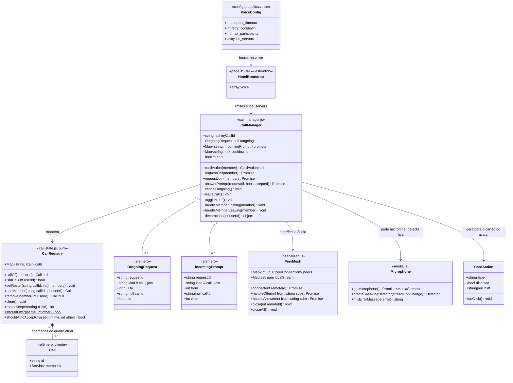

# República — Entrega 2: conversa por voz entre moradores no mesmo quarto

## Requirements

- Implementar a conversa por voz que substitui os balões de chat: dois moradores no mesmo quarto podem conversar em áudio depois que um pede e o outro aceita, e outras pessoas do quarto podem pedir para participar, até 5 pessoas por conversa.
- Garantir **consentimento**: ninguém ouve nem é ouvido sem aceitar explicitamente; o pedido inicial é aprovado pela destinatária, e o pedido de participação por **qualquer participante** (vale a primeira resposta).
- Tornar a conversa **visível e previsível** para todos no quarto: fone de ouvido sobre quem está em call, indicador de fala, pedidos que expiram em 30 s, nova tentativa só após 1 min de recusa.
- Manter a conversa **coerente com a presença**: sair do quarto, trocar de quarto, fechar a aba ou cair a conexão tira a pessoa da call; uma call com menos de 2 pessoas termina.
- Limites: construída sobre a entrega 1 (quartos, presença e whispers no canal `quarto.{id}`); sem gravação, sem vídeo, sem chat de texto, sem servidor de mídia; amizades e mensagens ficam para a entrega 3. Funciona em `localhost` e em HTTPS (exigência do navegador para o microfone).

## Entities

Notas do modelo:
- **Nada é persistido**: calls, pedidos e cooldowns vivem apenas nos clientes conectados ao canal `quarto.{id}`. O servidor só entrega configuração (`voice`) e autoriza o canal, como na entrega 1.
- **Identificadores**: `callId = "{idDeQuemAceitou}-{timestampMs}"`; `requestId = "{idDoRemetente}-{timestampMs}-{aleatório}"`.
- **Regras determinísticas** (iguais em todos os clientes): em cada par da malha, **o morador de id maior envia a oferta** WebRTC; em pedidos cruzados, **o morador de id menor aceita automaticamente**; o **membro de menor id** de cada call é o "guardião do roster" (reenvia o roster a quem chega e recusa automaticamente pedidos com a call cheia).

## Approach

1. **Sinalização descentralizada sobre a presença existente**:
   - Toda a coordenação da voz trafega como **whispers no canal de presença do quarto** (`quarto.{id}`) já usado pelo movimento — "mesmo quarto" é garantido pelo próprio canal, sem novas rotas nem estado no PHP.
   - Cada mensagem traz `id` (remetente) e, quando dirigida, `to`; os clientes ignoram mensagens que não lhes dizem respeito.
   - **Consistência sem servidor**: regras determinísticas por id resolvem as corridas — pedidos cruzados (id menor aceita), aprovações simultâneas (o solicitante só considera a primeira resposta para o seu `requestId` e ignora as demais), glare de WebRTC (id maior oferece), call cheia (guardião do roster recusa).
   - `RoomSession` ganha **ganchos** (`onJoining`, `onLeaving`, `beforeLeave`, whispers extras) para o `CallManager` acoplar sem duplicar a gestão do canal.

2. **Áudio WebRTC em malha (P2P)**:
   - Uma `RTCPeerConnection` por par de participantes, só áudio, com `echoCancellation`, `noiseSuppression` e `autoGainControl`.
   - **ICE sem trickle**: espera a coleta de candidatos terminar (ou 2 s) e envia a SDP completa numa única mensagem — menos whispers e lógica mais simples; SDP de áudio cabe no limite de 10 KB do Reverb.
   - Servidores ICE vêm do servidor (`config('republica.voice.ice_servers')`): STUN público por padrão e **TURN opcional por variáveis de ambiente**, para redes restritivas, sem mudar código.
   - Áudio remoto tocado em elementos `<audio autoplay>` ocultos, criados após um clique do usuário (pedir/aceitar), respeitando as políticas de autoplay.

3. **Microfone e indicador de fala**:
   - O microfone é pedido **antes** de enviar um pedido e **antes** de aceitar; se negado ou ausente, aparece o aviso com instrução e nada é enviado (ou o pedido recebido é recusado com motivo `mic`).
   - Detector de fala local (`AudioContext` + `AnalyserNode`, RMS com histerese) envia `call-speaking {on}` somente nas mudanças (no máximo 4 por segundo) — todos no quarto veem o avatar "pulsar", não só os participantes.
   - Botão "Silenciar" desliga a faixa local (`track.enabled = false`) e o indicador para.

4. **Experiência no quarto (retrô, sem chat)**:
   - Cartão do avatar ganha **um botão de ação** decidido pelo `CallManager`: "Conversar", "Pedir para participar" ou desabilitado com o motivo ("Você já está numa conversa", "Aguarde 1 min", "Conversa cheia", "Chamando…").
   - Janelas retrô para: pedido recebido (com contagem regressiva de 30 s), pedido enviado ("Chamando Ana…" + Cancelar), painel da conversa (participantes, Silenciar, Sair da conversa) e aviso de microfone.
   - No canvas: **fone de ouvido** acima da cabeça de quem está em call e **anel pulsante** sob os pés de quem está falando.
   - Avisos curtos (toast) para recusas, expiração, entradas e fim da conversa.

5. **Servidor (mínimo)**:
   - Apenas configuração: `config/republica.php` ganha a chave `voice`; `HotelController` inclui `voice` no bootstrap. Nenhuma rota, tabela ou evento novo. Tratamento de erros do servidor permanece o padrão do Laravel (`bootstrap/app.php`).

## Structure

### Inheritance Relationships
1. `CallRegistry`, `CallManager`, `PeerMesh` são classes ES; `Microphone` é um módulo de funções.
2. Nenhuma nova classe PHP; `HotelController` (existente) é estendido.
3. Testes PHP de feature continuam estendendo `Tests\TestCase`; testes JS usam `node:test` (nativo do Node, sem pacotes novos).

### Dependencies
1. `game.js` cria `CallManager(me, voiceConfig, ui, onChange)`, cria o `RoomSession` com `callManager.hooks()`, chama `callManager.attach(session)` e o conecta a `RoomSession` (ganchos), `AvatarCard` (ação do cartão) e `drawScene` (decorações por avatar).
2. `CallManager` depende de `CallRegistry` (`voice/call-state.js`), `PeerMesh` (`voice/peer-mesh.js`), `media.js` (`voice/media.js`) e `CallUi` (`voice/call-ui.js`); envia/recebe whispers via `RoomSession.whisper()` e os handlers registrados.
3. `PeerMesh` depende de `RTCPeerConnection` do navegador e de uma função `signal(event, payload)` fornecida pelo `CallManager`.
4. `renderer.js` usa `drawHeadset` e `drawSpeakingRing` de `avatar.js` a partir das decorações (`inCall`, `speaking`) entregues pelo `game.js`.
5. `HotelController@show` lê `config('republica.voice')`.

### Layered Architecture
1. **Configuração (PHP)**: `config/republica.php` → `voice`.
2. **Entrega de dados (PHP)**: `HotelController` injeta `voice` em `window.REPUBLICA`.
3. **Transporte em tempo real**: canal de presença `quarto.{id}` (Reverb) + whispers.
4. **Estado de domínio do cliente**: `CallRegistry` (puro, testável em Node).
5. **Orquestração**: `CallManager` (pedidos, aprovações, timers, cooldowns, entrada/saída, sincronização do roster).
6. **Mídia**: `PeerMesh` (WebRTC) + `media.js` (microfone, detector de fala).
7. **Apresentação**: `CallUi` (janelas e toasts), `AvatarCard` (botão de ação), `renderer.js`/`avatar.js` (fone e anel de fala).
8. **Tratamento de erros**: no cliente, toda falha de mídia/sinalização é capturada no `CallManager`, encerra só a conexão afetada e informa o usuário com mensagem em português; nunca quebra o laço de render.

## Operations

### 1. Update Config - `config/republica.php`
1. Adicionar a chave `voice`:
   - `request_timeout`: `30` (segundos para o pedido expirar)
   - `retry_cooldown`: `60` (segundos de espera após recusa)
   - `max_participants`: `5`
   - `ice_servers`: lista montada assim:
     - sempre `['urls' => env('REPUBLICA_STUN_URL', 'stun:stun.l.google.com:19302')]`
     - se `env('REPUBLICA_TURN_URL')` estiver definido, acrescentar `['urls' => env('REPUBLICA_TURN_URL'), 'username' => env('REPUBLICA_TURN_USERNAME'), 'credential' => env('REPUBLICA_TURN_CREDENTIAL')]`
2. `.env.example`: acrescentar `REPUBLICA_STUN_URL=`, `REPUBLICA_TURN_URL=`, `REPUBLICA_TURN_USERNAME=`, `REPUBLICA_TURN_CREDENTIAL=` com um comentário `# Voz: TURN opcional para redes restritivas`.

### 2. Update Controller - `app/Http/Controllers/HotelController.php`
1. Em `show()`, acrescentar ao array `bootstrap` a chave `'voice' => config('republica.voice')`. Nada mais muda.

### 3. Update Room Session - `resources/js/republica/room-session.js`
1. Construtor passa a aceitar um 4º parâmetro `hooks = {}` com: `onJoining(member)`, `onLeaving(member)`, `onEntered()`, `beforeLeave()` e `whispers: { [evento]: handler }`.
2. `enter()`:
   - após registrar `state`/`move`, registrar cada `hooks.whispers[evento]` com `listenForWhisper(evento, handler)`; cada handler é envolvido em `try/catch` (payload inválido é ignorado e logado com `console.warn`);
   - no callback `here`, depois de enviar o `state`, chamar `hooks.onEntered?.()`;
   - no `joining`, depois do comportamento atual, chamar `hooks.onJoining?.(member)`;
   - no `leaving`, **antes** de remover o avatar, chamar `hooks.onLeaving?.(member)`.
3. `leave()`: chamar `hooks.beforeLeave?.()` antes de `Echo.leave(...)`.
4. Tornar público o método `whisper(event, payload)` existente (já é usado internamente; apenas documentar como API para o `CallManager`).
5. Nenhuma mudança no movimento.

### 4. Create Module - `resources/js/republica/voice/call-state.js`
1. Responsibility: estado puro das calls do quarto atual (sem DOM, sem rede) — importável no Node.
2. `export class CallRegistry`:
   - `calls: Map<string, {id, members: Set<number>}>`
   - `callOf(userId)`: a call que contém o morador ou `null`.
   - `isInCall(userId)`: `callOf(userId) !== null`.
   - `setRoster(callId, members)`: remove cada membro listado de qualquer outra call (um morador, uma call), substitui a call `callId` por `members` (deduplicados); se ficar com menos de 2 membros, apaga a call.
   - `addMember(callId, userId)`: remove o morador de outra call, cria a call se não existir, adiciona; retorna a call.
   - `removeMember(userId)`: remove o morador da sua call; se a call ficar com menos de 2, apaga-a e retorna `{id, members: Set(restantes), ended: true}`; senão `{id, members, ended: false}`; `null` se não estava em call.
   - `clear()`.
   - `rosterKeeper(callId)`: menor id da call.
   - `static shouldOffer(me, other)`: `me > other`.
   - `static shouldAutoAcceptCrossed(me, other)`: `me < other`.
3. Exportar também `newRequestId(userId)` → `` `${userId}-${Date.now()}-${Math.random().toString(36).slice(2, 7)}` `` e `newCallId(userId)` → `` `${userId}-${Date.now()}` ``.

### 5. Create Module - `resources/js/republica/voice/media.js`
1. `getMicrophone(): Promise<MediaStream>` — `navigator.mediaDevices.getUserMedia({ audio: { echoCancellation: true, noiseSuppression: true, autoGainControl: true }, video: false })`; se `navigator.mediaDevices` não existir (contexto inseguro), rejeitar com `Error('insecure')`.
2. `micErrorMessage(error): string`:
   - `NotAllowedError`/`SecurityError` → "O navegador bloqueou o microfone. Clique no cadeado ao lado do endereço, permita o microfone e tente de novo."
   - `NotFoundError`/`OverconstrainedError` → "Nenhum microfone encontrado. Conecte um microfone e tente de novo."
   - `NotReadableError` → "O microfone está sendo usado por outro programa. Feche-o e tente de novo."
   - `insecure` → "A voz só funciona em endereço seguro (https ou localhost)."
   - outros → "Não foi possível ligar o microfone."
3. `createSpeakingDetector(stream, onChange): { stop() }` — `AudioContext` + `AnalyserNode` (`fftSize = 512`); a cada 100 ms calcula RMS do domínio do tempo; considera "falando" acima de `0.04` e "calado" abaixo de `0.02` por 400 ms (histerese); chama `onChange(bool)` só quando o estado muda; se a faixa estiver desabilitada (mudo), força `false`; `stop()` limpa o intervalo e fecha o `AudioContext`.

### 6. Create Module - `resources/js/republica/voice/peer-mesh.js`
1. Responsibility: uma `RTCPeerConnection` de áudio por participante remoto.
2. `constructor({ iceServers, signal, onPeerFailed })` — `signal(event, payload)` envia whispers; `onPeerFailed(remoteId)` informa queda.
3. `setLocalStream(stream)`; atributo `peers: Map<number, RTCPeerConnection>`; `audios: Map<number, HTMLAudioElement>`.
4. `createPeer(remoteId)` (interno): cria a conexão com `iceServers`, adiciona as faixas locais, em `ontrack` cria/atualiza `<audio autoplay>` oculto (anexado a `#voice-audio`) com o stream remoto; em `connectionstatechange` com `failed` → `onPeerFailed(remoteId)`.
5. `waitForIce(pc)` (interno): resolve quando `iceGatheringState === 'complete'` ou após 2000 ms.
6. `connect(remoteId)`: se já existe peer, retorna; cria peer, `createOffer()`, `setLocalDescription`, `waitForIce`, `signal('rtc-offer', { to: remoteId, sdp: pc.localDescription.sdp })`.
7. `handleOffer(from, sdp)`: cria (ou recria) o peer, `setRemoteDescription({type: 'offer', sdp})`, `createAnswer()`, `setLocalDescription`, `waitForIce`, `signal('rtc-answer', { to: from, sdp: pc.localDescription.sdp })`.
8. `handleAnswer(from, sdp)`: se existe peer em `have-local-offer`, `setRemoteDescription({type: 'answer', sdp})`; senão ignora.
9. `close(remoteId)`: fecha a conexão, remove e pausa o `<audio>`.
10. `closeAll()`: fecha todos os peers e para as faixas do stream local (`track.stop()`), zerando `localStream`.
11. Constraints: SDP enviada com no máximo 9000 caracteres; se maior, não envia e chama `onPeerFailed(remoteId)`.

### 7. Create Module - `resources/js/republica/voice/call-ui.js`
1. Responsibility: DOM da voz; nenhuma regra de negócio.
2. `export class CallUi` com:
   - `showIncoming({ requestId, kind, fromName, seconds, onAccept, onDecline })` — janela empilhada em `#call-prompts` com texto "{nome} quer conversar com você" (kind `call`) ou "{nome} quer participar da conversa" (kind `join`), contagem regressiva "30 s…" atualizada a cada segundo, botões "Aceitar" e "Recusar".
   - `closeIncoming(requestId)`.
   - `showOutgoing({ text, onCancel })` / `closeOutgoing()` — janela `#call-outgoing` ("Chamando {nome}…" ou "Pedindo para participar…") com botão "Cancelar".
   - `showCallPanel({ participants, meId, muted, speaking, onToggleMute, onLeave })` / `hideCallPanel()` — janela `#call-panel` "Conversa" com a lista de nomes (bolinha verde em quem fala), botão "Silenciar"/"Ativar microfone" e "Sair da conversa".
   - `showMicError(message)` — overlay `#mic-error` com a mensagem e botão "Entendi".
   - `toast(text)` — aviso temporário (4 s) em `#call-toasts`.
3. Todo texto de usuário via `textContent`.

### 8. Create Module - `resources/js/republica/voice/call-manager.js`
1. Responsibility: regras da conversa por voz e orquestração de mídia/sinalização.
2. Construtor `(me, voice, ui, onChange)` + `attach(session)` (a sessão é criada com `hooks()` e injetada depois, para evitar dependência circular): guarda referências; cria `registry = new CallRegistry()`, `mesh = new PeerMesh({ iceServers: voice.ice_servers, signal: (e, p) => this.send(e, p), onPeerFailed: (id) => this.handlePeerFailed(id) })`; estado: `myCallId = null`, `outgoing = null`, `prompts = new Map()`, `cooldowns = new Map()` (chave: `user:{id}` ou `call:{callId}` → timestamp de liberação), `speaking = new Set()`, `muted = false`, `detector = null`, `localStream = null`.
3. `hooks()` → objeto para o `RoomSession` com `onJoining`, `onLeaving`, `onEntered`, `beforeLeave` e `whispers` mapeando os eventos abaixo para métodos `on…`.
4. `send(event, payload)` → `session.whisper(event, { id: me.id, ...payload })`.
5. Utilitários: `nameOf(id)` (busca em `session.avatars`), `inRoom(id)`, `cooldownLeft(key)` (segundos restantes ou 0), `startCooldown(key)` (agora + `retry_cooldown`).
6. `cardAction(member): CardAction|null`
   - `null` se `member.id === me.id`.
   - Se `myCallId` e `registry.callOf(member.id)?.id === myCallId` → `null` (já conversam).
   - Se `myCallId` → `{ label: 'Conversar', disabled: true, hint: 'Você já está numa conversa' }`.
   - Se `outgoing` → `{ label: 'Chamando…', disabled: true }`.
   - Se `member` está em call `C`:
     - se `C.members.size >= max_participants` → `{ label: 'Pedir para participar', disabled: true, hint: 'Conversa cheia' }`;
     - se `cooldownLeft('call:' + C.id)` → `{ …, disabled: true, hint: 'Aguarde 1 min' }`;
     - senão `{ label: 'Pedir para participar', onClick: () => this.requestJoin(member) }`.
   - Senão: se `cooldownLeft('user:' + member.id)` → `{ label: 'Conversar', disabled: true, hint: 'Aguarde 1 min' }`; senão `{ label: 'Conversar', onClick: () => this.requestCall(member) }`.
7. `ensureMicrophone(): Promise<bool>` — se já há `localStream`, `true`; senão `getMicrophone()`, guarda o stream, `mesh.setLocalStream`, aplica `muted`; em erro → `ui.showMicError(micErrorMessage(e))` e retorna `false`.
8. `requestCall(member)`:
   - Revalidar `cardAction(member)` (se desabilitado, sair); se o alvo estiver em call, delegar a `requestJoin(member)`.
   - `if (!(await ensureMicrophone())) return;`
   - `outgoing = { requestId: newRequestId(me.id), kind: 'call', to: member.id, timer }` com `timer = setTimeout(() => this.expireOutgoing(), request_timeout * 1000)`.
   - `send('call-request', { to: member.id, requestId })`; `ui.showOutgoing({ text: 'Chamando ' + nome + '…', onCancel: () => this.cancelOutgoing() })`; `onChange()`.
9. `requestJoin(member)`:
   - `call = registry.callOf(member.id)`; validar tamanho e cooldown; `ensureMicrophone()`.
   - `outgoing = { requestId, kind: 'join', callId: call.id, to: null, timer }`; `send('join-request', { callId: call.id, requestId })`; `ui.showOutgoing({ text: 'Pedindo para participar…', onCancel })`.
10. `cancelOutgoing()` / `expireOutgoing()`:
    - `send('call-cancel', { requestId, to: outgoing.to, callId: outgoing.callId })`; `clearTimeout`; `outgoing = null`; `ui.closeOutgoing()`; em expiração → `ui.toast(kind === 'call' ? nome + ' não respondeu.' : 'Ninguém respondeu ao pedido.')`.
11. Handlers de whispers (todos validam tipos: ids inteiros, strings de até 64 caracteres; e que o remetente está no quarto):
    - `onCallRequest({ id, to, requestId })` (só se `to === me.id`):
      - (no caso cruzado abaixo, "limpar `outgoing`" inclui `clearTimeout` e `ui.closeOutgoing()`)
      - se `myCallId` → `send('call-answer', { to: id, requestId, accepted: false, busyCallId: myCallId })`;
      - se `outgoing?.kind === 'call' && outgoing.to === id` (cruzado): se `CallRegistry.shouldAutoAcceptCrossed(me.id, id)` → limpar `outgoing` (sem cancelar) e `acceptCall(id, requestId)`; senão ignorar (o outro aceitará);
      - senão criar prompt: `prompts.set(requestId, { kind: 'call', from: id, timer })` (expira em `request_timeout`, só fecha a janela) e `ui.showIncoming({ …, onAccept: () => this.answerPrompt(requestId, true), onDecline: () => this.answerPrompt(requestId, false) })`.
    - `onCallAnswer({ id, to, requestId, accepted, callId, busyCallId, reason })` (só se `to === me.id`):
      - se não corresponde a `outgoing.requestId`: se `accepted` e `callId` → `send('call-left', { callId })` (aceite tardio após cancelamento); sair.
      - limpar `outgoing` e `ui.closeOutgoing()`;
      - `accepted` → `joinCallLocally(callId, [id, me.id])`;
      - `busyCallId` → `requestJoin(membro id)` automaticamente;
      - recusado → `startCooldown('user:' + id)`; `ui.toast(reason === 'mic' ? nome + ' não conseguiu ligar o microfone.' : nome + ' recusou a conversa.')`.
    - `onCallCancel({ id, requestId })` → fechar o prompt correspondente, se existir.
    - `onJoinRequest({ id, callId, requestId })` (só se `myCallId === callId`):
      - se `call.members.size >= max_participants` → apenas o guardião (`rosterKeeper`) envia `join-answer { to: id, requestId, accepted: false, callId, reason: 'full' }`;
      - senão criar prompt kind `join` e `ui.showIncoming`.
    - `onJoinAnswer({ id, to, requestId, accepted, callId, reason })`:
      - todos os participantes: fechar o prompt `requestId` se existir (primeira resposta encerra o pedido para todos);
      - se `to === me.id` e `outgoing?.requestId === requestId`: limpar `outgoing`; `accepted` → `send('call-joined', { callId })` e `joinCallLocally(callId, [...membros conhecidos da call, me.id])`; recusado → `startCooldown('call:' + callId)` e `ui.toast(reason === 'full' ? 'A conversa está cheia.' : 'Seu pedido para participar foi recusado.')`.
    - `onCallJoined({ id, callId })` → `registry.addMember(callId, id)`; se `myCallId === callId`: `ui.toast(nome + ' entrou na conversa.')` e, se `shouldOffer(me.id, id)`, `mesh.connect(id)`; `onChange()`.
    - `onCallLeft({ id, callId })` → `handleDeparture(id)`.
    - `onCallRoster({ id, callId, members })` → se `myCallId !== callId`, `registry.setRoster(callId, members filtrados para quem está no quarto)`; `onChange()`.
    - `onCallSpeaking({ id, on })` → adiciona/remove `id` em `speaking` (apenas se `id` está em alguma call).
    - `onRtcOffer({ id, to, sdp })` (só se `to === me.id` e `id` está na minha call) → `mesh.handleOffer(id, sdp)`.
    - `onRtcAnswer({ id, to, sdp })` (só se `to === me.id`) → `mesh.handleAnswer(id, sdp)`.
12. `answerPrompt(requestId, accepted)`:
    - prompt `call`: recusar → `send('call-answer', { to: from, requestId, accepted: false })`; aceitar → `acceptCall(from, requestId)`.
    - prompt `join`: se `accepted` e `!(await ensureMicrophone())` não se aplica (já está em call); `send('join-answer', { to: from, requestId, accepted, callId })`.
    - Remover o prompt e `ui.closeIncoming(requestId)`.
13. `acceptCall(fromId, requestId)`:
    - `if (!(await ensureMicrophone())) { send('call-answer', { to: fromId, requestId, accepted: false, reason: 'mic' }); return; }`
    - se o remetente já não está no quarto → sair.
    - `callId = newCallId(me.id)`; `send('call-answer', { to: fromId, requestId, accepted: true, callId })`; `joinCallLocally(callId, [me.id, fromId])`; `send('call-roster', { callId, members: [me.id, fromId] })`.
14. `joinCallLocally(callId, members)`:
    - `registry.setRoster(callId, members)`; `myCallId = callId`;
    - para cada outro membro `m`: se `shouldOffer(me.id, m)` → `mesh.connect(m)` (os de id menor aguardam a oferta);
    - iniciar `detector = createSpeakingDetector(localStream, (on) => this.setSpeaking(on))`;
    - `ui.showCallPanel(...)`; `onChange()`.
15. `setSpeaking(on)` — atualiza `speaking` para `me.id`; envia `call-speaking { on }` respeitando no máximo 4 envios por segundo (último estado vence via timer); atualiza o painel.
16. `toggleMute()` — inverte `muted`, aplica `track.enabled = !muted` em todas as faixas locais, força `setSpeaking(false)` quando silenciado, atualiza o painel.
17. `leaveCall()` — se `myCallId`: `send('call-left', { callId: myCallId })`; `endLocalCall()`.
18. `endLocalCall(message)` — `mesh.closeAll()`; `detector?.stop()`; `localStream = null`; `registry.removeMember(me.id)`; `myCallId = null`; `speaking.delete(me.id)`; `ui.hideCallPanel()`; `message && ui.toast(message)`; `onChange()`.
19. `handleDeparture(id)` (call-left, presença `leaving`, falha de peer):
    - `result = registry.removeMember(id)`; `speaking.delete(id)`; `mesh.close(id)`;
    - se `result?.id === myCallId`: se `result.ended` → `endLocalCall('A conversa terminou.')`; senão `ui.toast(nome + ' saiu da conversa.')` e atualizar painel;
    - se o `id` tinha um prompt pendente para mim → fechar; se `outgoing?.to === id` → `expireOutgoing()` sem toast duplicado.
20. `handlePeerFailed(id)` → `ui.toast('A conexão de áudio com ' + nome + ' caiu.')` e `handleDeparture(id)` apenas localmente (não envia whisper).
21. Ganchos de presença:
    - `onJoining(member)`: para cada call em que `me` é o guardião (`rosterKeeper === me.id`) → `send('call-roster', { callId, members })`.
    - `onLeaving(member)`: `handleDeparture(member.id)`.
    - `onEntered()`: `registry.clear()`; `speaking.clear()`.
    - `beforeLeave()`: `leaveCall()`; cancelar `outgoing`; fechar todos os prompts (enviando recusa para os prompts `call` pendentes).
22. `decorations(userId)` → `{ inCall: registry.isInCall(userId), speaking: speaking.has(userId) }`.
23. Ao descarregar a página (`pagehide`), chamar `leaveCall()` (melhor esforço; a presença `leaving` cobre o resto).

### 9. Update Module - `resources/js/republica/avatar-card.js`
1. Adicionar ao cartão um botão `#card-action` e um texto `#card-hint`.
2. `open(member, screenPos, action)`: se `action` for `null`, esconder botão e dica; senão mostrar `action.label`, `disabled`, `hint`; clique → `action.onClick()` e fechar o cartão.
3. Expor `refresh(action)` para reavaliar o botão enquanto o cartão está aberto (chamado pelo `onChange` do jogo).

### 10. Update Modules - `resources/js/republica/avatar.js` e `renderer.js`
1. `avatar.js`:
   - `drawHeadset(ctx, x, y)`: arco de 14 px de raio em `#3e3431` (3 px) sobre a cabeça e duas conchas `#e8735a` 5×8 px nas laterais, centrado em `(x, y)`.
   - `drawSpeakingRing(ctx, x, y, time)`: elipse sob os pés, raio `14 + 3·sin(time·8)` × metade disso, traço `#9fbf9a` 2 px com alfa 0,9.
2. `renderer.js` → `drawScene`: o estado passa a ter `decorate(userId) → { inCall, speaking }` e `time`; para cada avatar, desenhar o anel de fala antes do avatar (se `speaking`) e o fone depois (se `inCall`), na altura da cabeça (pés − 62 px, considerando o assento).

### 11. Update Game - `resources/js/republica/game.js`
1. Criar `CallUi` e `CallManager(me, data.voice, ui, () => this.refreshPanels())`; criar o `RoomSession` com `callManager.hooks()`; chamar `callManager.attach(session)`.
2. Clique em avatar → `card.open(member, pos, callManager.cardAction(member))`.
3. `refreshPanels()` → também `card.refresh(callManager.cardAction(membroAberto))` quando o cartão estiver aberto.
4. `draw()` → passar `decorate: (id) => callManager.decorations(id)` e `time: performance.now() / 1000`.
5. `takeover()` → `callManager.leaveCall()` antes de sair dos canais.

### 12. Update View - `resources/views/hotel.blade.php`
1. No `#avatar-card`, abaixo de `<dl>`, adicionar `<button type="button" class="btn btn-primary hidden" id="card-action"></button>` e `

`.
2. Adicionar contêineres: `

`, `<section id="call-outgoing" class="window hidden">…</section>`, `<section id="call-panel" class="window hidden">` (título "Conversa", `<ul id="call-participants">`, botões `#btn-mute` e `#btn-leave-call`), `
` (janela com `
` e botão "Entendi"), `

` e `

`.

### 13. Update Styles - `resources/css/app.css`
1. Componentes: `#call-prompts` (pilha fixa no topo central, `z-index: 12`, largura 280 px), `.call-prompt` (janela com contagem e dois botões), `#call-outgoing` (fixo acima da barra inferior, centro), `#call-panel` (fixo à direita acima da barra, 220 px), `#call-participants li` com `.speaking::before` bolinha `--color-sage`, `#call-toasts` (pilha no topo, toasts com a animação existente), `.card-hint` (texto pequeno `--color-coral-dark`), `#avatar-card` largura 210 px para caber o botão.
2. Apenas tokens da paleta existente.

### 14. Update Env/Build - `package.json`
1. Acrescentar o script `"test:js": "node --test tests/js/"`.

### 15. Create Tests
1. `tests/js/call-state.test.js` (Node `node:test` + `node:assert`):
   - `setRoster` cria call; com 1 membro apaga.
   - `addMember` move o morador de outra call (um morador, uma call).
   - `removeMember` devolve `ended: true` quando sobra 1 e apaga a call; `ended: false` com 2+.
   - `rosterKeeper` é o menor id.
   - `shouldOffer(5, 3) === true`, `shouldOffer(3, 5) === false`; `shouldAutoAcceptCrossed(3, 5) === true`, inverso `false` (para cada par, exatamente um oferece e exatamente um aceita).
2. `tests/Feature/HotelTest.php`: novo teste — o bootstrap contém `voice` com `request_timeout = 30`, `retry_cooldown = 60`, `max_participants = 5` e `ice_servers[0].urls` começando com `stun:`.

## Norms

1. **Convenções**: seguir os módulos ES da entrega 1 (uma responsabilidade por arquivo, classes com estado explícito, `textContent` para todo texto de usuário, comentários curtos em português só onde a regra não é óbvia); novos módulos de voz ficam em `resources/js/republica/voice/`.
2. **Injeção de dependências**: `CallManager` recebe sessão, configuração e UI pelo construtor/`attach`; `PeerMesh` recebe `signal` e `onPeerFailed` por callback — nenhum módulo de voz acessa `window.REPUBLICA` diretamente.
3. **Tratamento de erros**:
   - Erros de microfone → `micErrorMessage()` + overlay; a call não começa.
   - Erros de WebRTC (`setRemoteDescription`, `createOffer`, conexão `failed`) → capturados no `PeerMesh`/`CallManager`, encerram somente o par afetado e geram toast em português; nunca lançam para o laço de render.
   - Whispers inválidos (tipos errados, remetente fora do quarto, `to` diferente de mim) → ignorados com `console.warn` curto.
   - No servidor, nada muda: validação e erros seguem o handler padrão do Laravel.
4. **Validação de dados**: ids sempre `Number.isInteger`; `requestId`/`callId` strings de até 64 caracteres; `sdp` string de até 9000 caracteres; `members` array de inteiros de até `max_participants` itens.
5. **Logging**: no cliente, `console.warn` apenas para payload inválido e falha de peer (sem conteúdo de SDP); no servidor, nenhum log novo.
6. **Tempo real**: nomes de whispers fixos — `call-request`, `call-answer`, `call-cancel`, `join-request`, `join-answer`, `call-joined`, `call-left`, `call-roster`, `call-speaking`, `rtc-offer`, `rtc-answer`; todo payload inclui `id` do remetente.
7. **Determinismo**: as regras de desempate (id maior oferece; id menor aceita cruzado; menor id é guardião) ficam centralizadas em `CallRegistry` e cobertas por teste.
8. **Testes**: `php artisan test` e `npm run test:js` devem passar; `npm run build` sem erros.

## Safeguards

1. **Functional Constraints**:
   - Só é possível pedir conversa ou participação a quem está no **mesmo quarto** (o próprio canal garante; o cliente também verifica `inRoom`).
   - Pedido inicial: só a destinatária aprova. Pedido de participação: qualquer participante aprova; a **primeira resposta** encerra o pedido para todos.
   - Pedidos expiram em **30 s**; após recusa, novo pedido à mesma pessoa (ou à mesma call) só depois de **60 s**.
   - Máximo **5** pessoas por call; pedido com a call cheia é recusado automaticamente com "A conversa está cheia.".
   - Um morador participa de no máximo **uma** call; com call ativa, não pode iniciar outra.
   - Pedidos cruzados resultam em **exatamente uma** call; pedido a quem já está em call vira **pedido de participação** automaticamente.
   - Sair do quarto, trocar de quarto, fechar a aba, perder a conexão ou ser desconectado por outra aba → sai da call; call com menos de 2 pessoas termina para todos com "A conversa terminou.".
   - Microfone negado ou ausente → overlay com instrução; nenhuma call começa.
   - Fone de ouvido visível para todos no quarto sobre quem está em call; anel de fala visível para todos enquanto a pessoa fala (e nunca quando silenciada).
   - Continua não existindo chat de texto nos quartos.
2. **Performance Constraints**:
   - Malha de no máximo 4 conexões por participante (call de 5).
   - `call-speaking`: no máximo 4 whispers por segundo por morador, apenas em mudanças de estado.
   - Sinalização WebRTC: exatamente 1 oferta e 1 resposta por par (ICE sem trickle); SDP ≤ 9000 caracteres (limite do Reverb 10 000).
   - Demais whispers de voz < 1 KB.
   - Áudio começa em até 3 s após o aceite numa rede comum (STUN).
   - O laço de render continua a 60 fps durante a call.
3. **Security Constraints**:
   - Áudio só é capturado após clique explícito em "Conversar", "Pedir para participar" ou "Aceitar"; o microfone é liberado (`track.stop()`) ao sair da call.
   - Áudio trafega direto entre navegadores (DTLS-SRTP do WebRTC); nada é gravado nem passa pelo servidor da aplicação.
   - Credenciais TURN somente via variáveis de ambiente; nunca versionadas.
   - Respostas `rtc-offer`/`rtc-answer` só são processadas se o remetente estiver na mesma call e `to` for o próprio morador.
4. **Integration Constraints**:
   - Reutiliza o canal `presence-quarto.{id}` e a autorização da entrega 1; nenhuma rota nova.
   - Exige `accept_client_events_from = members` (já configurado) e `max_message_size ≥ 10000` (padrão).
   - Microfone exige contexto seguro: `http://localhost` em desenvolvimento e HTTPS no Laravel Cloud.
   - Compatível com Chrome, Edge e Firefox de desktop atuais.
5. **Business Rule Constraints**:
   - Em todo par da malha, quem oferece é o morador de **id maior**; em pedido cruzado, quem aceita é o de **id menor**; o guardião do roster é o **menor id** da call.
   - `callId` é criado por quem aceita o pedido inicial e não muda enquanto a call existir.
   - Quem chega ao quarto recebe o roster das calls existentes do guardião de cada uma.
   - Aceite que chega depois de o pedido ter sido cancelado/expirado é desfeito com `call-left`.
6. **Exception Handling Constraints**:
   - Mensagens ao usuário sempre em português e sem detalhes técnicos (sem SDP, sem nomes de exceção).
   - Falha de um par não derruba a call inteira: só aquele par é encerrado.
   - Nenhum erro de voz pode interromper o movimento ou o desenho do quarto.
7. **Technical Constraints**:
   - Sem novos pacotes Composer ou npm; WebRTC e Web Audio nativos do navegador; testes JS com `node:test` nativo.
   - Sem servidor de mídia (SFU), sem vídeo, sem gravação.
   - Estado de voz 100% no cliente; nenhuma tabela ou evento de broadcast novo no Laravel.
8. **Data Constraints**:
   - Whispers validados conforme Norms §4; payloads fora do formato são descartados.
   - `voice.request_timeout`, `voice.retry_cooldown`, `voice.max_participants` inteiros positivos vindos do config.
9. **API Constraints**:
   - `window.REPUBLICA.voice = { request_timeout, retry_cooldown, max_participants, ice_servers: [{ urls, username?, credential? }] }`.
   - Whispers no canal `quarto.{id}`:
     - `call-request {id, to, requestId}`
     - `call-answer {id, to, requestId, accepted, callId?, busyCallId?, reason?}` (`reason` ∈ `mic`)
     - `call-cancel {id, requestId, to?, callId?}`
     - `join-request {id, callId, requestId}`
     - `join-answer {id, to, requestId, accepted, callId, reason?}` (`reason` ∈ `full`)
     - `call-joined {id, callId}`, `call-left {id, callId}`
     - `call-roster {id, callId, members}`
     - `call-speaking {id, on}`
     - `rtc-offer {id, to, sdp}`, `rtc-answer {id, to, sdp}`
