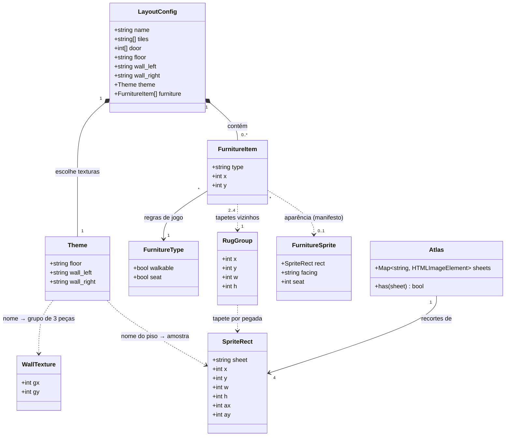

# República — gráficos do canvas em pixel art com o pack Cryovex (Free v1.01)

## Requirements
- Substituir todo o desenho do canvas do jogo (paredes, piso, porta, móveis, tapetes, avatar, cursor de tile, anel de fala, fone e etiqueta de nome) por **pixel art isométrica coerente**. A base são as spritesheets do pack *Pixel Isometric Modern Interior — Free v1.01* (Cryovex), ampliadas em **escala inteira 2×**.
- Manter o jogo idêntico em regras: projeção (`TILE_W`/`TILE_H`), pathfinding, `walkable`/`seat`, ordenação por profundidade, sessão, presença e voz não mudam. A única mudança de geometria é `WALL_H` (110 → 144).
- Preencher com **primitivas procedurais em pixel art** (mesma grade de 2 px, contorno escuro) o que o pack grátis não tem: planta, luminária, porta e marcações. Usar as mesmas primitivas como fallback quando uma spritesheet não carregar.
- Remover o experimento Kenney (`?mobilia=kenney`, `sprite-furniture.js`, `public/sprites/kenney/`) e os móveis vetoriais.
- Creditar o pack (arquivo `CREDITS.txt` + linha discreta na página do jogo) sem redistribuir o ZIP.
- Fora do escopo: interface HTML (exceto a linha de créditos), novos móveis, mudanças de layout, direção do avatar sentado e orientação de móveis soltos no meio do quarto (seguem a regra `y <= x`).

## Entities

## Approach
1. **Camada de dados visual (declarativa)**:
   - O `config/republica.php` ganha, em cada layout, a chave `theme` com nomes de textura (`floor`, `wall_left`, `wall_right`). Os hex atuais continuam como paleta das primitivas (porta, fallback). A config segue como fonte única do que cada quarto é.
   - Um **manifesto JS** (`atlas.js`) liga nomes a recortes das 4 spritesheets: texturas de piso, grupos de parede, móveis por tipo e tapetes por pegada. Cada recorte tem uma âncora nativa (`ax`, `ay`). O manifesto é apresentação pura, então fica no front e não aumenta o bootstrap.
   - Cada sprite de móvel declara a direção para a qual olha nativamente no pack (`facing`). A estante olha para **SW**, e os assentos (poltrona e módulo de sofá) olham para **SE**. Quando a direção desejada difere da nativa, o recorte é espelhado na horizontal em tempo de desenho (`ctx.scale(-1, 1)`). Os PNGs nunca são modificados.

2. **Implementação técnica (Canvas 2D, sem dependências)**:
   - **Escala**: `PX = 2` (1 pixel do pack = 2 px CSS). Todo `drawImage` usa destino `w*PX × h*PX` com `imageSmoothingEnabled = false` e origem arredondada.
   - **Paredes**: o pack tem blocos de 16×72 nativos com pegada de meio tile. Cada grupo de textura tem 3 peças de 16 px: `[0]` parede do fundo-direita (face pintada à esquerda), `[1]` canto, `[2]` parede do fundo-esquerda (face pintada à direita). As paredes ficam **por fora** do piso: blocos com pegada `[x-0,5, x] × [y, y+0,5]` (esquerda) e `[x, x+0,5] × [y-0,5, y]` (direita), 2 blocos por aresta de tile, mais 1 bloco de canto em `(-0,5, -0,5)` quando o tile (0,0) é piso. Âncora do bloco: vértice inferior da pegada = ponto nativo `(8, 68)` do recorte.
   - **Piso**: amostras de 16×10 nativas (losango 16×8 + 2 px de espessura) com pegada de meio tile. Cada tile recebe 2×2 amostras, desenhadas do fundo para a frente, para que as amostras da frente cubram a espessura das de trás. Âncora: vértice superior `(8, 0)`.
   - **Tapetes**: tiles `tapete` vizinhos são agrupados em retângulos (função pura `groupRugs`). Pegadas 2×1 e 1×2 usam o tapete 48×24 (espelhado para 1×2) e 2×2 usa o tapete 64×32. Qualquer outra pegada vira losangos primitivos por tile. Âncora: vértice inferior do grupo.
   - **Porta**: abertura escura desenhada coluna a coluna (2 px por coluna) sobre a face da parede esquerda, de 20% a 80% da aresta, com altura de 72 px e contorno de 2 px na cor `shade(wall_left, -0.35)`.
   - **Carregamento**: `loadAtlas()` (Promise com as 4 imagens, cada uma tolerante a erro) é chamada em `Game.start()`. `draw()` só pinta o fundo `VOID` até o atlas resolver.
   - **Fallback**: uma spritesheet ausente faz o piso virar losango primitivo com o hex `floor`, a parede virar faces primitivas com o hex da parede e o móvel virar um bloco primitivo com contorno. Nada lança exceção dentro do quadro.

3. **Regras de negócio visuais**:
   - Orientação: `item.y <= item.x` → SW, senão SE (a mesma regra de hoje). Espelha quando a direção desejada difere do `facing` nativo do sprite.
   - Profundidade: continua `x + y` (avatar +0,5). Paredes e piso são desenhados antes, e o tapete fica no chão, fora da ordenação.
   - Assento: cada sprite de assento declara `seat` (altura em px de tela). `avatarFoot` usa a altura do assento do tipo sob o avatar, e o hit-test (`game.js`) acompanha.
   - Avatar: o mesmo modelo de unidade (`u = 2 × scale`) ganha uma **passada de contorno** (cada retângulo é expandido 1 unidade em `INK` antes do preenchimento) e a sombra vira uma elipse em degraus. Afeta também a pré-visualização (cadastro, perfil e cartão), o que é desejado.
   - Marcações: cursor de tile = contorno de losango em degraus com preenchimento translúcido; anel de fala = elipse em degraus (pulsando por troca de raio inteiro); fone = arco em retângulos de 2 px + conchas; etiqueta de nome = retângulo com cantos chanfrados de 2 px e contorno de 2 px.

## Structure

### Inheritance Relationships
1. Não há hierarquia de classes. São módulos ES com funções puras e dados (convenção atual de `resources/js/republica/`).
2. `atlas.js` **substitui** `sprite-furniture.js`, com a mesma responsabilidade de "sprites do jogo", agora para todo o cenário.

### Dependencies
1. `game.js` chama `loadAtlas()` (`atlas.js`) e repassa `atlas` ao `drawScene` (`renderer.js`). Também passa `layout` para `avatarFoot` no hit-test.
2. `renderer.js` depende de `iso.js` (projeção, `WALL_H`), `atlas.js` (manifesto e `drawSprite`), `pixel.js` (primitivas), `rugs.js` (`groupRugs`) e `avatar.js` (`drawAvatar`, `drawHeadset`, `drawSpeakingRing`, `shade`).
3. `avatar.js` depende de `pixel.js` (elipse em degraus e retângulos alinhados).
4. `atlas.js` depende de `iso.js` (`TILE_W`) só para conferir a escala.
5. `HotelController` continua repassando `config('republica.layouts')` sem mudanças, e `theme` viaja junto.

### Layered Architecture
1. Config (PHP): `config/republica.php`, com layouts e o novo `theme`.
2. Bootstrap (Controller): `HotelController`, sem mudança.
3. Dados de apresentação (JS): `atlas.js`, com manifesto, carregador e desenho de recorte, e `rugs.js`, com o agrupamento puro.
4. Primitivas (JS): `pixel.js`, com o desenho em grade de 2 px.
5. Cena (JS): `renderer.js` (camadas e ordenação) e `avatar.js` (personagem e marcações).
6. Orquestração (JS): `game.js` (loop, carregamento, hit-test).
7. Assets estáticos: `public/sprites/cryovex/*.png` + `CREDITS.txt`.

## Operations

### 1. Adicionar assets — `public/sprites/cryovex/`
1. Copiar, **sem alterar**, `floor_free.png`, `wall_free.png`, `furniture_free.png` e `decoration_free.png` da versão Free v1.01.
2. Criar `public/sprites/cryovex/CREDITS.txt` com o nome do pack, o autor (Cryovex), o link `https://cryovex.itch.io/pixel-isometric-modern-interior`, a versão (Free v1.01) e o resumo da licença (uso comercial permitido, sem revenda nem redistribuição, mesmo modificado).
3. Remover `public/sprites/kenney/` (12 PNGs + LICENSE.txt).

### 2. Atualizar config — `config/republica.php`
1. Acrescentar `'theme' => [...]` a cada layout (nomes válidos no manifesto):
   - `sala`: `floor => 'bege'`, `wall_left => 'laranja'`, `wall_right => 'laranja'`
   - `jardim`: `floor => 'cinza'`, `wall_left => 'listrado'`, `wall_right => 'verde'`
   - `por-do-sol`: `floor => 'bege'`, `wall_left => 'laranja'`, `wall_right => 'terracota'`
   - `estudio`: `floor => 'madeira'`, `wall_left => 'painel'`, `wall_right => 'ardosia'`
   - `sala-de-estar`: `floor => 'bege'`, `wall_left => 'laranja'`, `wall_right => 'verde'`
2. Atualizar o comentário do cabeçalho: `theme` escolhe texturas do pack, e os hex continuam como paleta de apoio.

### 3. Criar módulo de primitivas — `resources/js/republica/pixel.js`
1. Responsabilidade: desenhar formas nítidas na grade de 2 px, sem caminhos antialiasados.
2. Constantes: `PX = 2`, `INK = '#2b2523'`.
3. Funções:
   - `snap(v): number`: `Math.round(v)`.
   - `rect(ctx, x, y, w, h, color)`: `fillRect` com coordenadas arredondadas.
   - `diamondRows(cx, topY, w, h)`: lista de faixas `{ y, x0, x1 }` de altura `PX`. Para cada linha `i` (0 a `h/PX - 1`), a meia-largura é proporcional à distância ao meio, arredondada a múltiplos de `PX`. É a base de losango e elipse.
   - `fillDiamond(ctx, cx, topY, w, h, color)`: preenche as faixas.
   - `strokeDiamond(ctx, cx, topY, w, h, color)`: pinta só os `PX` px das extremidades de cada faixa.
   - `ellipseRows(cx, cy, rx, ry)`: faixas de altura `PX` com meia-largura `rx·√(1 − (dy/ry)²)` arredondada a `PX`.
   - `fillEllipse(ctx, cx, cy, rx, ry, color)` / `strokeEllipse(ctx, cx, cy, rx, ry, color)`: o contorno pinta extremidades e a faixa do topo e da base.
   - `wallFace(ctx, p1, p2, height, color)`: paralelogramo vertical entre dois pontos de tela (a aresta inferior inclinada), preenchido coluna a coluna (`PX` de largura). A coluna em `x` vai de `y(x) - height` até `y(x)`, com `y(x)` interpolado e arredondado.
   - `block(ctx, x, y, w, h, color)`: retângulo com contorno `INK` de `PX` (fallback genérico).
4. Restrições: nenhuma chamada de `arc`, `ellipse`, `stroke`, `roundRect` ou gradiente neste módulo.

### 4. Criar agrupador de tapetes — `resources/js/republica/rugs.js`
1. `groupRugs(furniture): Array<{x, y, w, h}>`.
   - Lógica: coletar as posições `tapete` num `Set`. Percorrer as posições em ordem (y, depois x). Para cada posição não usada, tentar o retângulo 2×2, depois 2×1 (x, x+1) e depois 1×2 (y, y+1), aceitando o primeiro em que todas as células existem e não foram usadas. Se nenhum servir, usar 1×1. Marcar as células como usadas.
   - Retorno: retângulos em coordenadas de tile.
2. Função pura, sem DOM, testável em Node.

### 5. Criar atlas — `resources/js/republica/atlas.js` (substitui `sprite-furniture.js`)
1. Constantes:
   - `SHEETS = { floor: 'floor_free.png', wall: 'wall_free.png', furniture: 'furniture_free.png', decoration: 'decoration_free.png' }`, base `/sprites/cryovex/`.
   - `FLOORS` (amostra 16×10, âncora `(8, 0)`): `madeira: [0, 6]`, `bege: [96, 6]`, `branco: [48, 6]`, `marmore: [80, 6]`, `cinza: [0, 22]`.
   - `WALLS` (origem do grupo de 48×72; peça `i` em `gx + 16i`): `madeira: [80, 8]`, `bege: [128, 8]`, `painel: [176, 8]`, `cinza: [0, 88]`, `listrado: [48, 88]`, `verde: [96, 88]`, `ardosia: [144, 88]`, `laranja: [192, 88]`, `marinho: [0, 168]`, `terracota: [48, 168]`, `marrom: [96, 168]`. Constantes `WALL_W = 16`, `WALL_SRC_H = 72`, âncora `(8, 68)`.
   - `FURNITURE` (âncora no vértice inferior do tile = `(w/2, h-1)`; `facing` = direção nativa no pack):
     - `poltrona: { sheet: 'furniture', x: 2, y: 160, w: 34, h: 35, facing: 'SE', seat: 12 }`
     - `sofa: { sheet: 'furniture', x: 73, y: 160, w: 30, h: 33, facing: 'SE', seat: 12 }`
     - `mesa: { sheet: 'furniture', x: 73, y: 436, w: 32, h: 20, facing: 'SW' }`
     - `estante: { sheet: 'furniture', x: 430, y: 240, w: 34, h: 66, facing: 'SW' }`
   - `RUGS` (decoration, âncora no vértice inferior do grupo `(w/2, h-1)`): `'2x2': { x: 84, y: 384, w: 64, h: 32 }` e `'2x1': { x: 248, y: 384, w: 48, h: 24 }` (`'1x2'` = `'2x1'` espelhado).
2. Funções:
   - `loadAtlas(): Promise<Atlas>`: para cada folha, `new Image()` + `decode()`. Em caso de erro, a folha não entra no `Map`. Resolve sempre. Retorna `{ sheets: Map, has(name) }`.
   - `facing(item): 'SW' | 'SE'`: `item.y <= item.x ? 'SW' : 'SE'`.
   - `drawSprite(ctx, atlas, sheet, sx, sy, sw, sh, ax, ay, px, py, flip = false): boolean`: se a folha não existir, retorna `false`. Caso contrário, desenha o recorte em escala `PX` com o ponto nativo `(ax, ay)` sobre o ponto de tela `(px, py)` arredondado. Com `flip`, faz `translate(px, py)` + `scale(-1, 1)` e espelha a âncora (`ax` passa a ser medido a partir da direita). Usa `save/restore` e `imageSmoothingEnabled = false`. Retorna `true`.
   - `seatHeight(type): number`: `FURNITURE[type]?.seat ?? 0`.
3. Remover `resources/js/republica/sprite-furniture.js`.

### 6. Atualizar projeção — `resources/js/republica/iso.js`
1. `WALL_H = 144` (72 nativos × 2). Nada mais muda.

### 7. Reescrever cena — `resources/js/republica/renderer.js`
1. Remover `drawBlock`, `furnitureDrawers`, `polygon`, `SEAT_HEIGHT` e os gradientes.
2. `drawWalls(ctx, layout, camera, atlas)`:
   - Para cada tile de piso `(x, y)`: se `!isFloor(x-1, y)`, desenhar 2 blocos da parede esquerda com vértice inferior em `toScreen(x, y + 0.5)` e `toScreen(x, y + 1)` (peça 2 do grupo `theme.wall_left`). Se `!isFloor(x, y-1)`, desenhar 2 blocos da direita com vértice inferior em `toScreen(x + 0.5, y)` e `toScreen(x + 1, y)` (peça 0 de `theme.wall_right`).
   - Ordem: a parede esquerda de cima para baixo (`y` crescente) e a direita da esquerda para a direita (`x` crescente). Antes de tudo, se `(0, 0)` for piso, desenhar o bloco de canto (peça 1 de `theme.wall_left`) com vértice inferior em `toScreen(0, 0)`.
   - Fallback (folha ausente): `wallFace` com a cor hex correspondente sobre a aresta e altura `WALL_H`, mais o topo em `INK`.
   - Porta: após a parede, no tile `door`, desenhar `wallFace` em `VOID` entre os pontos a 20% e 80% da aresta `(x, y)→(x, y+1)`, altura 72, e contornar com `wallFace` de 2 px nas bordas usando `shade(layout.wall_left, -0.35)`.
3. `drawFloor(ctx, layout, camera, atlas)`: para cada tile de piso, nas subposições `(x + i/2, y + j/2)` com `i, j ∈ {0, 1}`, em ordem de `y + j/2`, depois `x + i/2`, varrendo a planta inteira por meias-linhas para manter a ordem de trás para a frente, desenhar a amostra `FLOORS[theme.floor]` com âncora `(8, 0)` no `toScreen` da subposição. Fallback: `fillDiamond` com o hex `layout.floor` e `strokeDiamond` com `shade(floor, -0.1)`.
4. `drawRugs(ctx, layout, camera, atlas)`: `groupRugs(layout.furniture)`. Para cada grupo, escolher `RUGS['2x2']` (w=h=2), `RUGS['2x1']` (w=2,h=1) ou `RUGS['2x1']` espelhado (w=1,h=2). O ponto de tela é `toScreen(g.x + g.w, g.y + g.h)` (vértice inferior). Senão, ou se a folha faltar, usar `fillDiamond` + `strokeDiamond` por tile com `#f4b393`/`#9fbf9a` alternados e `INK`.
5. `drawFurniture(ctx, camera, item, atlas)`: com `FURNITURE[item.type]`, `drawSprite` no `toScreen(item.x + 1, item.y + 1)` com `flip = facing(item) !== sprite.facing`. `planta` → `drawPlant`, `luminaria` → `drawLamp`. Tipo desconhecido → nada. Folha ausente → `pixel.block` com pegada aproximada.
6. `drawPlant(ctx, camera, item)` e `drawLamp(ctx, camera, item)`: em grade de `PX`, centradas em `toScreen(x + 0.5, y + 0.5)`.
   - Planta: vaso trapezoidal terracota (`#c4573f`, sombra `#a8452f`) com 12 px de altura, e copa de 3 elipses em degraus (`#6f9a78`, `#9fbf9a`, `#7fae86`) com contorno `INK` desenhado antes (elipses 2 px maiores).
   - Luminária: base `INK` (12×4), haste 4×52, cúpula trapezoidal creme `#f6ead8` com contorno e brilho em 2 anéis de `fillEllipse` com `rgba(244,179,147,0.25)` e `0.15`, sem gradiente.
7. `avatarFoot(avatar, camera, grid, layout)`: o `lift` passa a ser `seatHeight(typeAt(layout, x, y))` quando `avatar.sitting && grid.seat(...)`. `typeAt` busca o primeiro item não tapete na posição, com memoização por layout em `WeakMap`.
8. `drawNameTag(ctx, x, y, name)`: largura `ceil(measureText) + 12` arredondada para par. Corpo creme com cantos chanfrados (sem os 4 pixels de canto), contorno `INK` de `PX` feito com `rect` e texto `bold 11px` com `textBaseline = 'middle'` em coordenadas inteiras.
9. `drawScene(ctx, state)`: fundo `VOID`. Se `!state.atlas`, encerra. Depois, em ordem: `drawWalls`, `drawFloor`, `drawRugs`, cursor (`fillDiamond` translúcido `rgba(246,234,216,0.25)` + `strokeDiamond` creme num losango de 64×32 em `toScreen(x, y)`), itens ordenados (móveis + avatares, como hoje) e etiqueta do avatar sob o mouse.

### 8. Atualizar avatar — `resources/js/republica/avatar.js`
1. `drawAvatar`: acumular os retângulos numa lista (mesmos valores de hoje). Primeiro pintar cada retângulo expandido 1 unidade para cada lado em `INK` (silhueta), depois os preenchimentos. A sombra vira `fillEllipse(0, 0, 12·scale, 5·scale, 'rgba(43,37,35,0.25)')` arredondada à grade `u`. A origem continua `Math.round(footX/Y)`.
2. `drawHeadset(ctx, x, y)`: arco em degraus com 7 retângulos de 4×4 px em `#3e3431` formando a ponte sobre a cabeça, mais duas conchas `#e8735a` de 6×8 com contorno `INK` de 2 px.
3. `drawSpeakingRing(ctx, x, y, time)`: `r = 14 + 2·round(1.5·sin(time·8))` (inteiro e par). Usar `strokeEllipse(x, y, r, r/2, 'rgba(159,191,154,0.9)')`.
4. `renderPreview` sem mudança de assinatura. Ela já usa `imageSmoothingEnabled = false` e herda o novo contorno.

### 9. Atualizar orquestração — `resources/js/republica/game.js`
1. Trocar o import de `sprite-furniture` por `loadAtlas` de `./atlas`. Renomear `this.sprites` para `this.atlas` (inicial `null`).
2. Em `start()`: `loadAtlas().then((atlas) => (this.atlas = atlas))` incondicional, sem parâmetro de URL.
3. `draw()`: passar `atlas: this.atlas` (em vez de `sprites`). O renderer pinta só o `VOID` enquanto for `null`.
4. `avatarAt`: chamar `avatarFoot(avatar, this.camera, this.session.grid, this.layout)`.

### 10. Créditos na página — `resources/views/hotel.blade.php` + `resources/css/app.css`
1. Acrescentar `
Móveis e cenário: <a href="https://cryovex.itch.io/pixel-isometric-modern-interior" target="_blank" rel="noopener">Pixel Isometric Modern Interior</a>, por Cryovex
` após o `<canvas>`.
2. CSS: `#credits` fixo no canto inferior direito, acima da barra (`bottom: 56px; right: 8px`), com `font-size: 10px`, opacidade 0,6, cor creme e `pointer-events` só no link.

### 11. Testes
1. `tests/js/rugs.test.js`: 2×2 → um grupo `{w:2,h:2}`, par em x → `{w:2,h:1}`, par em y → `{w:1,h:2}`, tile isolado → `{w:1,h:1}`, móveis que não são tapete são ignorados, e os layouts reais da config (`sala-de-estar` com 4 tapetes) geram 1 grupo.
2. `tests/js/atlas.test.js`: `facing` segue `y <= x`, todo sprite de `FURNITURE` declara `facing` (`SW` ou `SE`), `seatHeight('sofa') > 0`, `seatHeight('mesa') === 0`, todos os nomes de `FLOORS`/`WALLS` usados pelos temas existem (com os nomes de tema fixados no teste, espelhando a config), e todos os recortes cabem nas dimensões das folhas (floor 128×48, wall 256×240, furniture 512×768, decoration 512×496).
3. `tests/Feature/HotelTest.php`: um teste que confere que cada layout de `config('republica.layouts')` tem `theme.floor`, `theme.wall_left` e `theme.wall_right`, e que o bootstrap os entrega ao cliente.

## Norms
1. **Estilo do código**: módulos ES sem classes para desenho, nomes e comentários em português, comentários curtos só onde a regra não é óbvia (como em `iso.js` e `renderer.js`). Usar `const` e funções nomeadas exportadas.
2. **Grade de pixel**: toda coordenada de desenho passa por `Math.round`. Tamanhos de primitiva são múltiplos de `PX`. Nunca usar `arc`, `ellipse`, `roundRect`, `createRadialGradient` ou `stroke()` para desenho do jogo. O texto da etiqueta é a única exceção antialiasada.
3. **Sprites**: sempre por `drawSprite` (âncora + escala 2×). Nada de `drawImage` direto fora de `atlas.js`.
4. **Erros**: falha de rede no atlas é silenciosa (folha ausente → fallback). O loop de `game.js` já captura exceções por quadro. Não acrescentar `console.error` novo.
5. **Config**: os nomes de `theme` em `config/republica.php` devem existir no manifesto. Os testes JS e PHP fixam essa ligação.
6. **PHP**: seguir o estilo atual (arrays curtos, chaves em snake_case, `pint`). Rodar `vendor/bin/pint --dirty` se houver alteração em PHP.

## Safeguards
1. **Funcionais**:
   - Os 5 layouts renderizam piso, paredes, tapetes e móveis do pack, e não sobra nenhum `drawBlock`/polígono vetorial no código.
   - Móveis com `y <= x` são desenhados olhando para SW e os demais para SE. O espelhamento depende do `facing` nativo de cada sprite.
   - Um avatar atrás de uma estante (profundidade menor) é coberto, e na frente fica visível.
   - O avatar sentado é elevado exatamente `seat` px do tipo sob ele, e o hit-test usa a mesma elevação.
2. **Visuais**: com DPR 1 e 2, cada pixel do pack ocupa exatamente 2×2 ou 4×4 pixels físicos. A suavização fica desligada em todo `drawImage`.
3. **Desempenho**: até ~1.000 `drawImage` por quadro no quarto 16×14 (piso 896 amostras + ~60 blocos de parede + móveis), aceitável em Canvas 2D a 60 fps. Não criar objetos `Image` por quadro.
4. **Integração**: as assinaturas públicas usadas por outros módulos continuam: `drawScene(ctx, state)`, `avatarFoot` (com um 4º parâmetro opcional; sem ele, `lift = 0`), `drawAvatar`, `renderPreview`, `drawHeadset`, `drawSpeakingRing` e `shade`. `iso.js` só muda `WALL_H`.
5. **Regras de jogo**: `config/republica.php → furniture_types`, as plantas (`tiles`), `door` e `furniture` não mudam. Só entra a chave `theme`.
6. **Licença**: os PNGs entram sem modificação em `public/sprites/cryovex/`. O ZIP não entra no repositório e `CREDITS.txt` + a linha na página são obrigatórios.
7. **Limpeza**: `?mobilia=kenney`, `spritesRequested`, `loadFurnitureSprites`, `sprite-furniture.js` e `public/sprites/kenney/` deixam de existir (`grep -r kenney resources public` vazio).
8. **Testes**: `npm run test:js` e `php artisan test` passam. `npm run build` compila sem erros.
