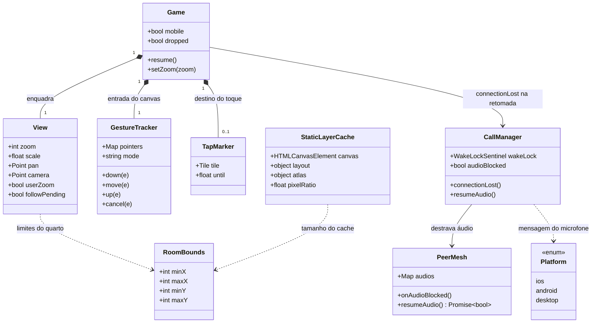

# República — jogável pelo celular (toque, zoom inteiro, interface compacta e voz móvel)

## Requirements
- Liberar o hotel no celular (iOS Safari e Android Chrome, a partir de 360×640, retrato e paisagem) com o mesmo endereço, a mesma conta e o mesmo jogo do computador, para que os amigos pratiquem idiomas por voz também pelo celular.
- Mostrar o quarto em **zoom de escala inteira** (1× ou 2× do pack) com arrasto e pinça, e controlar o jogo por **toque** (andar, abrir cartão), sem quebrar a nitidez da pixel art.
- Reorganizar a interface no **modo celular** (barra de ícones com menu "⋯", faixa do quarto, painéis inferiores, alvos ≥ 44 px, áreas seguras).
- Tornar a voz confiável no celular: destravar áudio, mensagens de microfone por plataforma, retomada após segundo plano com aviso de call perdida e tela acesa durante a call.
- Manter o computador **exatamente como está**: escala 2×, clique, hover, etiqueta de nome e janelas.
- Ajuste do critério de aceite 1: em 1×, a Sala de estar mede 480×~330 px CSS e **não cabe inteira em 360 px de largura** sem escala fracionária, que é proibida. Em 360×640 retrato, a pessoa vê a maior parte do quarto em 1× e alcança o resto arrastando. Quartos privados (10×10, 320×~250 px em 1×) cabem inteiros.
- Fora do escopo: PWA, joystick, mudanças de regras de jogo e voz, otimização própria para tablet e configuração de TURN (operacional).

## Entities

## Approach
1. **Vista sobre o mundo atual**:
   - O mundo continua em "px de mundo" (o 2× do pack). A vista tem `zoom ∈ {1, 2}` e `scale = zoom / 2` (0,5 ou 1). O `game.js` aplica `ctx.setTransform(dpr·scale, …)` e converte a entrada de tela em mundo com `world = css / scale`. `iso.js`, `pixel.js`, `atlas.js`, o pathfinding e o contrato de `drawScene` continuam iguais.
   - Câmera = enquadramento centralizado do quarto na área útil (tela menos a barra) mais um `pan` limitado. Com escala 0,5, a câmera é arredondada para valores **pares**, para que cada pixel do pack caia num pixel CSS inteiro.
   - Zoom padrão: fora do modo celular, sempre 2. No modo celular, 2 se o quarto couber, senão 1. A escolha manual (pinça ou botão) vale até trocar de quarto.
   - Arrasto: em cada eixo, se o quarto cabe, o `pan` é 0. Se não cabe, o `pan` fica limitado a `±(extensão − área) / 2`, e a borda do quarto nunca entra na tela.
   - Seguir o avatar: ao entrar no quarto e enquanto o próprio avatar anda, se os pés ou a cabeça ficarem a menos de 48 px CSS da borda, o `pan` se desloca o mínimo necessário e é limitado de novo.
2. **Entrada unificada por Pointer Events**:
   - Um classificador puro (`gestures.js`) recebe `down/move/up/cancel` de qualquer `pointerType` e emite `tap`, `pan(dx, dy)` e `pinch('in' | 'out')`. O gesto vira arrasto acima de 10 px. Dois dedos viram pinça, que dispara uma vez a razão ≥ 1,25 (in) ou ≤ 0,8 (out) e nunca gera toque.
   - O mouse usa o mesmo caminho: clique = `tap` (o `click` atual sai). O hover continua em `pointermove` só para `pointerType === 'mouse'`. No computador o quarto cabe, então o arrasto não faz nada e a experiência fica igual.
   - No toque, a área de acerto do avatar é `max(28, 44/scale) × max(64, 44/scale)` em mundo, e o toque no piso mostra o losango de destino por 600 ms.
3. **Interface do modo celular (CSS + ganchos mínimos)**:
   - A media query `(pointer: coarse) and (max-width: 899px)` define o modo celular. O JS usa a mesma string (`MOBILE_QUERY`).
   - Barra: rótulos em `` escondidos no celular. `#btn-zoom` e `#btn-more` só aparecem no celular. Perfil e Sair ficam em `#more-menu` (inline no computador, suspenso no celular).
   - `#room-info` vira uma faixa no topo, e tocar no título alterna `.expanded` para mostrar as pessoas. `#navigator` e `#avatar-card` viram painéis inferiores de largura total, um por vez. `#call-panel` vira uma faixa fixa acima da barra (não exclusiva) e os painéis sobem acima dela. `#call-prompts` fica no topo, sobre tudo.
   - Áreas seguras com `viewport-fit=cover` + `env(safe-area-inset-*)`. Altura com `100dvh`. `touch-action: none` no canvas e `overscroll-behavior: none` no hotel. Alvos ≥ 44 px e inputs com 16 px no celular (evita o zoom do iOS).
4. **Voz e retomada**:
   - `platformOf(userAgent, maxTouchPoints)` escolhe a mensagem de microfone (Safari iOS, Chrome Android ou desktop atual).
   - `PeerMesh` avisa `onAudioBlocked` quando `play()` falha com `NotAllowedError` e oferece `resumeAudio()`. O `CallManager` tenta destravar a cada `pointerdown` da página enquanto houver áudio bloqueado e mostra ou esconde o aviso "🔈 Toque para ouvir a conversa".
   - Wake Lock: pedido em `joinCallLocally`, solto em `endLocalCall` e pedido de novo no `visibilitychange → visible` se ainda houver call. Sem suporte, nada acontece.
   - Retomada: o `game.js` observa o `state_change` do pusher. Após `connected → (outro)`, marca `dropped`. Ao voltar a `connected` com `dropped`, chama `calls.connectionLost()` (encerra a call local com aviso), faz `session.leave()` + `session.enter()` do mesmo quarto e `presence.announce()`. A `RepublicPresence` limpa `online`/`locations` em cada `here()`.
5. **Desempenho**: paredes, piso e tapetes são desenhados uma vez num canvas fora da tela, na resolução física (`dpr·scale`), com chave `(layout, atlas, pixelRatio)`. Por quadro há só um `drawImage` do cache mais móveis e avatares. O `requestAnimationFrame` já pausa em aba oculta.

## Structure

### Inheritance Relationships
1. Não há hierarquia nova. São módulos ES com funções puras (`view.js`, `gestures.js`, `platform.js`) e extensões das classes existentes (`Game`, `CallManager`, `PeerMesh`, `CallUi`, `AvatarCard`, `RepublicPresence`).

### Dependencies
1. `game.js` usa `view.js` (`MOBILE_QUERY`, `defaultZoom`, `computeCamera`, `clampPan`, `followPan`) e `gestures.js` (`createGestures`). Chama `calls.connectionLost()` e a sessão/presença na retomada.
2. `view.js` usa `iso.js` (`TILE_W`, `TILE_H`, `WALL_H`). `renderer.js` usa `view.js` (`roomBounds`) para o cache estático.
3. `call-manager.js` usa `platform.js` (`platformOf`) e `media.js` (`micErrorMessage(error, platform)`). `PeerMesh` recebe `onAudioBlocked`.
4. `avatar-card.js` usa `MOBILE_QUERY` (`view.js`) para não se posicionar no celular.
5. A view `hotel.blade.php` e o `app.css` definem a estrutura e o layout. `layouts/app.blade.php` ganha `viewport-fit=cover`.

### Layered Architecture
1. Apresentação HTML/CSS: `layouts/app.blade.php`, `hotel.blade.php`, `app.css` (modo celular).
2. Lógica pura de interação: `view.js`, `gestures.js`, `platform.js`.
3. Orquestração: `game.js` (vista, entrada, painéis, retomada).
4. Cena: `renderer.js` (cache estático, etiqueta fora da escala).
5. Voz: `media.js`, `peer-mesh.js`, `call-ui.js`, `call-manager.js`.
6. Presença: `republic-presence.js`.

## Operations

### 1. Layout base — `resources/views/layouts/app.blade.php`
1. Viewport: `<meta name="viewport" content="width=device-width, initial-scale=1, viewport-fit=cover">`.

### 2. Hotel — `resources/views/hotel.blade.php`
1. Remover o bloco `#desktop-only`.
2. Barra (`#toolbar`), na ordem:
   - `<button type="button" class="btn" id="btn-common" aria-label="Sala de estar">🛋️ Sala de estar</button>`
   - `btn-home` (🏠 Meu quarto) e `btn-nav` (🧭 Navegador), no mesmo padrão.
   - `<button type="button" class="btn mobile-only" id="btn-zoom" aria-label="Zoom">🔍</button>`
   - `` e `conectando…`
   - `<button type="button" class="btn mobile-only" id="btn-more" aria-label="Mais opções" aria-expanded="false">⋯</button>`
   - `
` com o link Perfil (`👤 Perfil`, `aria-label="Perfil"`) e o `<form>` de Sair (botão "Sair"), movidos para dentro dele.
3. Aviso de áudio: `<button type="button" id="audio-unlock" class="window hidden">🔈 Toque para ouvir a conversa</button>` antes de `#call-toasts`.

### 3. Estilos — `resources/css/app.css`
1. Geral (todos os modos): `#game { height: 100dvh; touch-action: none; }`, `body.hotel { overscroll-behavior: none; }`, `.mobile-only { display: none; }`, `#more-menu { display: contents; }`, `#audio-unlock` fixo no topo centralizado (`z-index: 14`, `padding: 10px 14px`, `font: bold 12px`, `cursor: pointer`). Remover as regras de `#desktop-only`.
2. Bloco `@media (pointer: coarse) and (max-width: 899px)`:
   - `:root { --bar-h: calc(60px + env(safe-area-inset-bottom)); --call-h: 0px; }` e `body.hotel:has(#call-panel:not(.hidden)) { --call-h: 64px; }`.
   - `input:not([type=radio]):not([type=checkbox]) { font-size: 16px; }`, `.btn { min-height: 44px; min-width: 44px; }`.
   - Barra: `padding: 8px max(8px, env(safe-area-inset-right)) calc(8px + env(safe-area-inset-bottom)) max(8px, env(safe-area-inset-left)); gap: 4px;`, `.label { display: none; }`, `.mobile-only { display: inline-flex; align-items: center; justify-content: center; }`, `#status { font-size: 10px; }`.
   - `#more-menu`: `display: none; position: fixed; right: 8px; bottom: calc(var(--bar-h) + 8px); flex-direction: column; gap: 6px; padding: 8px;` com o visual de `.window`. `#more-menu.open { display: flex; }`. Os filhos têm 100% de largura.
   - `#room-info`: `top: calc(8px + env(safe-area-inset-top)); left: 8px; right: 8px; width: auto;`. `#room-info .content` escondido, exceto com `#room-info.expanded`. O título ganha `cursor: pointer; min-height: 44px; display: flex; align-items: center`.
   - Painéis: `#navigator, #avatar-card { top: auto; left: 8px !important; right: 8px; bottom: calc(var(--bar-h) + var(--call-h) + 8px); width: auto; max-height: 60dvh; overflow-y: auto; }` (o `!important` vence o `left` inline antigo do cartão).
   - `#room-list li { min-height: 44px; }`. `.titlebar { padding-right: 52px; }` e `.titlebar .close { top: 0; right: 0; width: 44px; height: 100%; border-radius: 0 5px 0 0; }`.
   - `#call-panel`: `left: 8px; right: 8px; bottom: calc(var(--bar-h) + 8px); width: auto;`. `#call-panel .titlebar { display: none; }`. `#call-panel .content { display: flex; align-items: center; gap: 6px; padding: 6px 8px; }`. `#call-participants` com `flex: 1; display: flex; flex-wrap: wrap; gap: 2px 8px; margin: 0; font-size: 10px;`.
   - `#call-outgoing { bottom: calc(var(--bar-h) + var(--call-h) + 8px); }`. `#call-prompts { top: calc(8px + env(safe-area-inset-top)); }`. `#credits { bottom: calc(var(--bar-h) + 4px); }`.

### 4. Vista — `resources/js/republica/view.js` (novo, puro)
1. Constantes: `MOBILE_QUERY = '(pointer: coarse) and (max-width: 899px)'` e `FOLLOW_MARGIN = 48` (px CSS).
2. `roomBounds(layout): {minX, maxX, minY, maxY}`, em mundo e relativo à origem da câmera:
   - `minX = -(rows + 0.5) * TILE_W/2 - 16`
   - `maxX = (cols + 0.5) * TILE_W/2 + 16`
   - `minY = -WALL_H - 32`
   - `maxY = (cols + rows) * TILE_H/2 + 16`
3. `scaleOf(zoom) = zoom / 2`.
4. `fits(layout, viewW, viewH, zoom): boolean`: largura e altura dos limites × `scale` ≤ área útil.
5. `defaultZoom(layout, viewW, viewH, mobile): 1 | 2`: `!mobile || fits(..., 2) ? 2 : 1`.
6. `clampPan(layout, viewW, viewH, zoom, pan): {x, y}`: por eixo, com `world = view / scale` e `extent = max − min`: se `extent ≤ world`, retorna 0; senão limita a `±(extent − world) / 2`.
7. `computeCamera(layout, viewW, viewH, zoom, pan): {x, y}`: `world = view / scale` e `c = world / 2 − (min + max) / 2 + pan`. Arredonda: com `scale = 0.5`, para o par mais próximo (`2·round(c/2)`); senão `round`.
8. `followPan(layout, viewW, viewH, zoom, pan, camera, foot, headTop = 64): {x, y}`: em mundo, `m = FOLLOW_MARGIN / scale`. Se `foot.x < m`, aumenta `pan.x` em `m − foot.x`. Se `foot.x > worldW − m`, diminui. Faz o mesmo em `y` com `foot.y − headTop` (topo) e `foot.y` (base). O resultado passa por `clampPan`.
9. `toWorld(x, y, zoom) = { x: x / scale, y: y / scale }`.

### 5. Gestos — `resources/js/republica/gestures.js` (novo, puro)
1. Constantes: `TAP_SLOP = 10`, `PINCH_IN = 1.25`, `PINCH_OUT = 0.8`.
2. `createGestures({ onTap, onPan, onPinch })` retorna `{ down, move, up, cancel }`, todos recebendo `{ id, x, y, type }`. Estado: `pointers: Map<id, {x, y, sx, sy}>` e `mode ∈ 'idle' | 'press' | 'pan' | 'pinch' | 'done'`.
   - `down`: registra o ponteiro. Com 1 ponteiro, `mode = 'press'`. Com 2, `mode = 'pinch'`, guarda a distância inicial e zera `pinched`. Com mais de 2, ignora.
   - `move`: ignora ids desconhecidos. Em `press`, se a distância ao início for maior que `TAP_SLOP`, vira `pan` e emite `onPan` com o deslocamento desde o início. Em `pan`, emite `onPan(dx, dy)` desde o último ponto. Em `pinch` sem `pinched`, calcula `ratio = dist / dist0` e emite `onPinch('in')` se `≥ PINCH_IN` ou `onPinch('out')` se `≤ PINCH_OUT`, marcando `pinched = true`. Sempre atualiza o último ponto.
   - `up`: se `mode === 'press'` e o ponteiro existe, emite `onTap(x, y, type)`. Remove o ponteiro. Sem ponteiros, `mode = 'idle'`. Se sobrou ponteiro depois de uma pinça, `mode = 'done'` (nada até soltar todos).
   - `cancel`: remove o ponteiro sem emitir nada. Sem ponteiros, `idle`. Senão, `done`.

### 6. Plataforma — `resources/js/republica/platform.js` (novo, puro)
1. `platformOf(userAgent = '', maxTouchPoints = 0): 'ios' | 'android' | 'desktop'`: `/iPhone|iPad|iPod/` ou (`/Macintosh/` com `maxTouchPoints > 1`) → `ios`. `/Android/` → `android`. Senão, `desktop`.

### 7. Microfone — `resources/js/republica/voice/media.js`
1. `micErrorMessage(error, platform = 'desktop')`: só o caso `NotAllowedError`/`SecurityError` muda por plataforma.
   - `ios`: `'O Safari bloqueou o microfone. Toque em "aA" na barra de endereço, abra "Ajustes do Site", permita o Microfone e tente de novo.'`
   - `android`: `'O Chrome bloqueou o microfone. Toque no ícone ao lado do endereço, abra "Permissões", permita o Microfone e tente de novo.'`
   - `desktop`: a mensagem atual, sem mudança.

### 8. Áudio da malha — `resources/js/republica/voice/peer-mesh.js`
1. O construtor aceita `onAudioBlocked` (opcional).
2. Em `ontrack`: `audio.play().catch((error) => { if (error?.name === 'NotAllowedError') this.onAudioBlocked?.(); })`.
3. `resumeAudio(): Promise<boolean>`: `Promise.allSettled` de `play()` em todos os `audios`. Retorna `true` se nenhum foi rejeitado (ou se não há áudios).

### 9. UI da voz — `resources/js/republica/voice/call-ui.js`
1. No construtor, `this.audioUnlock = document.getElementById('audio-unlock')` e o clique chama `this.handlers.onAudioUnlock?.()`.
2. `showAudioBlocked(onTap)`: guarda o handler e remove `hidden`. `hideAudioBlocked()`: adiciona `hidden`.

### 10. Regras da voz — `resources/js/republica/voice/call-manager.js`
1. O `PeerMesh` recebe `onAudioBlocked: () => this.audioBlockedNow()`.
2. `audioBlockedNow()`: `this.audioBlocked = true` e `ui.showAudioBlocked(() => this.resumeAudio())`.
3. `resumeAudio()`: `this.mesh.resumeAudio().then((ok) => { if (ok) { this.audioBlocked = false; this.ui.hideAudioBlocked(); } })`.
4. No construtor: `document.addEventListener('pointerdown', () => { if (this.audioBlocked) this.resumeAudio(); })` e `document.addEventListener('visibilitychange', () => { if (document.visibilityState === 'visible' && this.myCallId) this.requestWakeLock(); })`.
5. `requestWakeLock()`: se `navigator.wakeLock` existe e não há lock ativo, `navigator.wakeLock.request('screen').then((lock) => { this.wakeLock = lock; lock.addEventListener('release', () => { if (this.wakeLock === lock) this.wakeLock = null; }); }).catch(() => {})`.
6. `releaseWakeLock()`: `this.wakeLock?.release().catch(() => {})` e `this.wakeLock = null`.
7. `joinCallLocally`: chama `requestWakeLock()`. `endLocalCall`: chama `releaseWakeLock()`, além de `audioBlocked = false` e `ui.hideAudioBlocked()`.
8. `ensureMicrophone`: `micErrorMessage(error, platformOf(navigator.userAgent, navigator.maxTouchPoints))`.
9. `connectionLost()`: se `this.myCallId`, `endLocalCall('A conversa caiu enquanto você estava fora. Peça para entrar de novo.')`.

### 11. Presença — `resources/js/republica/republic-presence.js`
1. No `here(members)`, antes de preencher: `this.online.clear()` e `this.locations.clear()`.

### 12. Cartão — `resources/js/republica/avatar-card.js`
1. Em `open`: se `window.matchMedia(MOBILE_QUERY).matches`, zera `style.left`/`style.top` e não calcula a posição. Senão, mantém o cálculo atual.

### 13. Cena — `resources/js/republica/renderer.js`
1. Cache estático:
   - `drawStatic(ctx, layout, camera, atlas, pixelRatio)`: `bounds = roomBounds(layout)`, `w = maxX − minX`, `h = maxY − minY`. Se a chave em cache (`layout`, `atlas`, `pixelRatio`) for diferente, cria um `canvas` de `ceil(w·pixelRatio) × ceil(h·pixelRatio)`, aplica `setTransform(pixelRatio, 0, 0, pixelRatio, 0, 0)` e `imageSmoothingEnabled = false`, e chama `drawWalls`, `drawFloor` e `drawRugs` com a câmera local `{x: −minX, y: −minY}`.
   - Depois, `ctx.drawImage(cache, camera.x + minX, camera.y + minY, w, h)` com `imageSmoothingEnabled = false`.
   - Uma entrada de cache só (o quarto atual).
2. `drawScene(ctx, state)`: usa `drawStatic(..., state.pixelRatio ?? 1)` no lugar das três chamadas.
3. Etiqueta de nome fora da escala: com `scale = state.scale ?? 1`, desenhar com `ctx.save(); ctx.scale(1/scale, 1/scale); drawNameTag(ctx, foot.x·scale, (foot.y − 82)·scale, …); ctx.restore()`.

### 14. Orquestração — `resources/js/republica/game.js`
1. Imports novos: `view.js` e `createGestures`. Remover `BOTTOM_BAR` (a altura vem de `#toolbar.offsetHeight`) e `fitCamera`.
2. Estado no construtor:
   - `this.mobileQuery = matchMedia(MOBILE_QUERY)`, `this.zoom = 2`, `this.userZoom = false`, `this.pan = {x:0, y:0}`, `this.followPending = false`, `this.tapMarker = null`, `this.dropped = false`.
   - Elementos `#toolbar`, `#more-menu`, `#btn-more`, `#room-info`.
3. `viewSize()`: `{ w: this.width, h: this.height − toolbar.offsetHeight }`.
4. `reframe()`: se não há layout, sai. Se não for `userZoom`, `zoom = defaultZoom(layout, w, h, mobileQuery.matches)`. Depois `pan = clampPan(...)` e `camera = computeCamera(...)`.
5. `setZoom(z)`: `zoom = z`, `userZoom = true`, `pan = {0,0}`, `followPending = true` e `reframe()`.
6. `goTo`: troca `fitCamera` por `userZoom = false; pan = {0,0}; followPending = true; reframe()`. No modo celular, fecha `#navigator`.
7. `resize()`: igual ao atual, trocando o cálculo de câmera por `followPending = true; reframe()`.
8. `bindUi()`:
   - `btn-zoom` chama `setZoom(zoom === 2 ? 1 : 2)`.
   - `btn-more` alterna `#more-menu.open` e `aria-expanded`. Um `pointerdown` fora de `#more-menu` e `#btn-more` fecha o menu.
   - O título `#room-title` alterna `#room-info.expanded`.
   - `btn-nav`: ao abrir no modo celular, chama `card.close()`.
   - Canvas:
     - `pointerdown`: `setPointerCapture` e `gestures.down`.
     - `pointermove`: mouse atualiza `this.mouse`, depois `gestures.move`.
     - `pointerup`: `gestures.up`.
     - `pointercancel`: `gestures.cancel`.
     - `pointerleave`: só o mouse zera `this.mouse`.
     - Remover o `click`.
   - Gestos:
     - `onTap: (x, y, type) => this.handleTap(x, y, type)`
     - `onPan: (dx, dy) => { pan += d/scale; pan = clampPan(...); camera = computeCamera(...) }`
     - `onPinch: (dir) => setZoom(dir === 'in' ? 2 : 1)`
9. `avatarAt(px, py, touch = false)`: converte para mundo com `toWorld`. `hitW = touch ? max(HIT_W, 44/scale) : HIT_W` e `hitH = touch ? max(HIT_H, 44/scale) : HIT_H`. O resto é igual.
10. `handleTap(px, py, type)`, que substitui o `handleClick`:
    - `touch = type !== 'mouse'`.
    - Se acertar um avatar: no modo celular fecha `#navigator`, depois `card.open(...)` (posição em px CSS) e sai.
    - Senão: `tile = toTile(world)`, `session.moveTo(tile)` e, se `touch`, `tapMarker = { tile, until: now + 600 }`.
11. `draw()`:
    - Se `followPending` ou o próprio avatar anda, calcula `foot = avatarFoot(mine, camera, grid, layout)`, `pan = followPan(...)`, `camera = computeCamera(...)` e `followPending = false` (só quando `mine` existe).
    - `ctx.setTransform(dpr·scale, 0, 0, dpr·scale, 0, 0)` e `imageSmoothingEnabled = false`.
    - `drawScene` com `width = this.width/scale` e `height = this.height/scale`.
    - `hoverTile`: o do mouse (em mundo) ou o `tapMarker` ativo.
    - `pixelRatio = dpr·scale` e `scale`.
12. Retomada `watchResume()`, chamado em `start()`:
    - `connection.bind('state_change', ({ previous, current }) => { if (previous === 'connected' && current !== 'connected') this.dropped = true; if (current === 'connected' && this.dropped) { this.dropped = false; this.resume(); } })`.
    - `resume()`: se não há `currentRoomId`, sai. Senão `calls.connectionLost()`, `session.leave()`, `session.enter(currentRoomId, layout)`, `presence.announce(currentRoomId)`, `followPending = true` e `refreshPanels()`.

### 15. Testes
1. `tests/js/view.test.js`:
   - `defaultZoom`: 2 fora do modo celular. No modo celular, 1 para a Sala de estar em 360×580 e 2 para um quarto 10×10 em 900×400 se couber.
   - `clampPan`: 0 quando cabe, limitado quando não cabe.
   - `computeCamera`: par com zoom 1.
   - `followPan`: traz um pé fora da margem para dentro.
   - `toWorld`.
2. `tests/js/gestures.test.js`:
   - Toque curto vira `tap`.
   - Movimento acima de 10 px vira `pan` sem `tap`.
   - Pinça abrindo dispara um `pinch('in')` só, e fechando dispara `out`.
   - Soltar um dedo depois da pinça não gera `tap`.
   - `cancel` não gera `tap`.
3. `tests/js/platform.test.js`:
   - UA de iPhone, iPad "Macintosh" com toque, Android e desktop.
   - `micErrorMessage` por plataforma para `NotAllowedError`, e o caso desktop igual ao atual.
4. `tests/Feature/HotelTest.php`:
   - `/hotel` não contém `desktop-only` e contém `btn-zoom`, `more-menu` e `audio-unlock`.

## Norms
1. **Estilo**: módulos ES, funções nomeadas exportadas, nomes e comentários em português, comentários curtos só para regras não óbvias. Classes só onde já existem.
2. **Lógica pura separada do DOM**: `view.js`, `gestures.js` e `platform.js` não tocam em `window` nem em `document` no carregamento, e são testados com `node --test`. Imports com extensão `.js` nesses módulos e nos que os testes importam.
3. **Pixel art**: toda transformação de vista é `dpr·scale` com `scale ∈ {0.5, 1}`. A câmera é par em 0,5 e a suavização fica desligada em todo desenho de imagem (inclusive o cache).
4. **CSS**: tudo que é celular fica no bloco `@media (pointer: coarse) and (max-width: 899px)`. O desktop só ganha regras neutras (`.mobile-only` escondido, `#more-menu` como `display: contents`, `dvh`, `touch-action`).
5. **Erros**: falhas de Wake Lock, `play()` e `matchMedia` são silenciosas (`catch(() => {})`). Sem `console.error` novo.
6. **PHP**: `vendor/bin/pint --dirty` se houver alteração em PHP.

## Safeguards
1. **Funcionais**:
   - No modo celular, toque curto anda ou abre o cartão. Arrasto (> 10 px) e pinça nunca andam nem abrem o cartão.
   - O zoom é sempre 1 ou 2 e o arrasto fica limitado ao quarto (a borda nunca entra na tela no eixo em que o quarto não cabe).
   - Ao voltar de uma queda de conexão, o morador está no mesmo quarto, sem avatares fantasmas. Se estava em call, recebe o aviso "A conversa caiu enquanto você estava fora. Peça para entrar de novo." e não reentra sozinho.
   - O aviso "🔈 Toque para ouvir a conversa" só aparece depois de um `NotAllowedError` e some quando o áudio toca.
2. **Computador inalterado**: sem o modo celular, zoom 2, câmera centralizada como no `fitCamera` anterior (a mesma área útil; diferença de até 8 px por causa das margens de `roomBounds`), hover, etiqueta, clique e janelas iguais. Os botões `🔍` e `⋯` ficam invisíveis e Perfil/Sair aparecem inline como hoje.
3. **Visuais**: com DPR 1, 2 ou 3 e zoom 1 ou 2, cada pixel do pack ocupa um número inteiro de pixels físicos. O cache estático tem a mesma nitidez do desenho direto.
4. **Desempenho**: no máximo um `drawImage` para a camada estática por quadro. O cache só é refeito ao trocar de quarto, de atlas ou de `pixelRatio`.
5. **Acessibilidade e toque**: todo botão da barra, item do navegador e botão de fechar tem ≥ 44×44 px CSS no modo celular. Botões só com ícone têm `aria-label`.
6. **Integração**: as assinaturas usadas por outros módulos continuam (`drawScene(ctx, state)` com campos opcionais novos `scale` e `pixelRatio`, `avatarFoot`, `micErrorMessage(error)` com plataforma opcional, `iso.js` sem mudanças).
7. **Regras de jogo e voz**: pathfinding, limites da call (30 s, 1 min, 5 pessoas), takeover e protocolo de whispers não mudam.
8. **Testes**: `npm run test:js`, `php artisan test` e `npm run build` passam.
