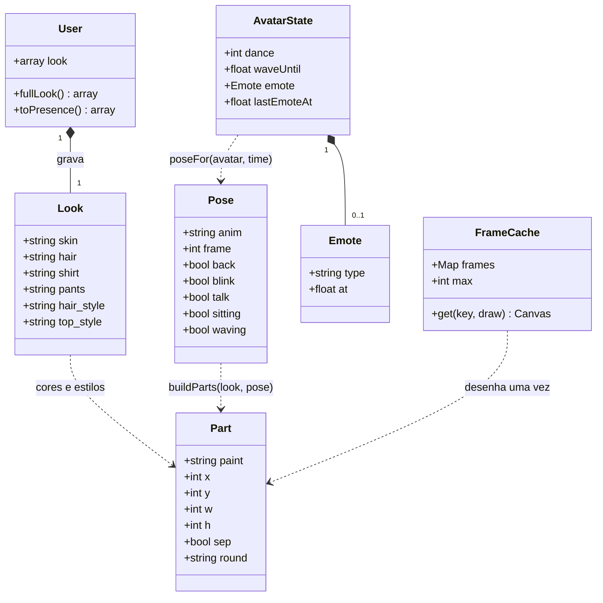

# República — avatar no estilo Habbo, animações e emotes (CC0)

## Requirements
- Redesenhar o avatar procedural com acabamento de jogo profissional no estilo do Habbo: partes separadas com contorno, 3 tons por cor, rosto expressivo, 4 direções e 4 cabelos e 3 partes de cima à escolha. Tudo continua desenhado por código com as cores do cadastro.
- Dar vida ao quarto com animações vistas por todos: parado (respira e pisca), andar em 4 quadros, sentar de frente para o assento, 3 danças, acenar e boca mexendo ao falar na call.
- Oferecer **emotes em balão** (11 tipos, pack CC0 *Tiny Speech Indicators*) como forma de reagir sem texto, preservando a regra de que a conversa é por voz.
- Manter a compatibilidade: contas antigas ganham estilos padrão sem migração, o servidor valida estilos e chaves do `look`, e as regras de pixel art (escala inteira, grade de 2 px) e do modo celular continuam valendo.
- Decisões fechadas neste Canvas:
  - Atalhos `1`–`9` = os 9 primeiros emotes da lista, de Feliz a Oi. Amei e Música ficam só no seletor.
  - Clicar no próprio avatar abre o seletor de danças, em vez de um cartão.
  - O aceno é sobreposto (só o braço) e não cancela a dança nem o sentar.
  - Sentado, não dá para dançar.
- Fora do escopo: texto no quarto, acessórios e loja, sons, sincronizar o ritmo da dança e animações de móveis.

## Entities

## Approach
1. **Rig puro + desenhista com cache**:
   - `avatar-rig.js` (puro, testável) monta a lista de partes `{ paint, x, y, w, h, sep }` em unidades da grade (1 unidade = 1 pixel do pack = 2 px CSS no zoom 2), com a origem nos pés, para a vista "direita" (frente-direita ou costas-direita).
   - `avatar.js` pinta as partes:
     1. passada de silhueta: cada parte expandida em 1 unidade, em `INK`
     2. para cada parte com `sep`, contorno próprio (separa braço do tronco, cabeça do corpo)
     3. preenchimento com 3 tons: coluna da esquerda em luz, base no meio e coluna da direita e linha de baixo em sombra (luz vindo da esquerda, como no pack)
   - As vistas da esquerda saem por espelhamento (`dir = -1`). A sombra no chão é uma elipse pixelada.
   - Cada quadro é desenhado uma vez num canvas fora da tela, na resolução física (`pixelRatio`), e guardado num cache LRU de 400 entradas com chave `look + back + pose + pixelRatio`.
2. **Proporção estilo Habbo** (unidades, origem nos pés, olhando para a direita):
   - sapatos `y −2..0`, pernas `−9..−2`, tronco `−18..−9` (8 de largura)
   - braços de 2 de largura, de `−17` a `−10`, com a mão em pele
   - pescoço `−19` e cabeça de 10×11 em `y −30..−19`
   - topo do cabelo até `−32` (altura parecida com a de hoje; `HEAD_TOP` 62 px continua válido)
   - rosto à direita: olhos 1×2 em `x 1` e `x 3` com 1 pixel de brilho, sobrancelhas em cor de cabelo sombra, boca em `y −21`, nariz em 1 pixel de sombra de pele
   - na vista de costas, a cabeça é coberta de cabelo e não tem rosto
3. **Animação por relógio** (`animation.js`, puro):
   - `poseFor({ walking, walkPhase, sitting, dance, waving, talking, time, seed })` devolve a `Pose`.
   - Andar: 4 quadros a partir de `walkPhase`. Parado: respira com 2 quadros de 0,75 s.
   - Piscar: 150 ms a cada 3–6 s, com fase por `seed = member.id`.
   - Falar: boca alterna a cada 120 ms. Dança: 4 quadros a 6 fps. Aceno: 6 quadros em 1,5 s.
   - Prioridade: sentar > andar > dançar > parado. O aceno e a fala são sobrepostos.
4. **Ação e emotes sincronizados** (`RoomSession`):
   - O estado do avatar ganha `dance` (0 = nenhuma, 1–3), `waveUntil`, `emote` e `lastEmoteAt`.
   - Whispers novos: `action` `{ id, kind: 'dance', value }` ou `{ id, kind: 'wave' }`, e `emote` `{ id, type }`. Ambos são validados contra listas fechadas.
   - O `state` passa a levar `dance`. `applyPath` e o fim de caminho em assento zeram `dance`, local e remoto.
   - Limite de emote: 2 s na origem e 1,9 s no destino (tolerância de rede).
5. **Emotes** (`emotes.js`):
   - Catálogo fechado de 11 tipos com o recorte do pack ou o ícone desenhado.
   - Renderização após todos os itens: balão 22×22 px ancorado à direita da cabeça, com a animação de entrada (8 quadros de 50 ms) e duração de 4 s. "Atenção" usa a exclamação animada (6 quadros).
6. **Aparência no servidor**:
   - `config/republica.php` ganha `look_styles` e os estilos no `default_look`.
   - `ValidatesResidentProfile` restringe as chaves do `look` (`array:` + chaves conhecidas) e valida os estilos com `sometimes` + `in`.
   - `User::fullLook()` devolve o merge com `default_look` e é usado em `toPresence()` e no perfil.
7. **Interface**:
   - Botões `😊 Emotes` e `💃 Dançar` na barra.
   - Painéis `#emote-picker` e `#dance-picker` no padrão `.window`, que no celular viram painéis inferiores e entram em "um painel por vez" (junto com navegador e cartão).
   - Atalhos de teclado só fora do modo celular e fora de campos de texto.
   - O seletor de aparência ganha os chips de cabelo e de parte de cima.

## Structure

### Inheritance Relationships
1. Não há classes novas no PHP. No JS, só módulos de funções puras (`avatar-rig.js`, `animation.js`, `emotes.js`) e extensões de `RoomSession`, `Game` e `avatar.js`.

### Dependencies
1. `avatar.js` → `avatar-rig.js`, `animation.js` (tipos), `pixel.js`.
2. `renderer.js` → `animation.js` (`poseFor`), `avatar.js` (`drawAvatar`), `emotes.js` (`drawEmote`), `atlas.js` (folhas de emote, `facing`, `FURNITURE`).
3. `room-session.js` → `animation.js` (`DANCES`, `canEmote`) e `emotes.js` (`isEmote`).
4. `game.js` → `emotes.js` (`EMOTES`, para o seletor e os atalhos) e `RoomSession` (`dance`, `wave`, `emote`).
5. `profile-form.js` → `avatar.js` (`renderPreview`), agora com estilos.
6. PHP: `ValidatesResidentProfile` → `config('republica.look_styles')`. `User::toPresence()` → `fullLook()`. `ProfileController`/`RegisterController` → passam `styles` ao `look-picker`.

### Layered Architecture
1. Config e validação (PHP): `config/republica.php`, `ValidatesResidentProfile`, `User`.
2. Views: `partials/look-picker.blade.php`, `hotel.blade.php`.
3. Lógica pura (JS): `avatar-rig.js`, `animation.js`, `emotes.js` (catálogo e validação).
4. Desenho (JS): `avatar.js`, `renderer.js`, `emotes.js` (`drawEmote`).
5. Estado e rede: `room-session.js`.
6. Orquestração e interface: `game.js`, `profile-form.js`, `app.css`.
7. Assets: `public/sprites/pigeonivy/` (PNGs CC0 + `README.txt`).

## Operations

### 1. Assets — `public/sprites/pigeonivy/`
1. Copiar sem alterar `tiny_speech_indicators-11x11.png`, `speech_bubble_animation-11x11.png`, `exclamation-7x8.png` e o `README.txt` (CC0) do pack.
2. Atualizar `#credits` em `hotel.blade.php`: "Móveis e cenário: … por Cryovex · Emotes: <a href="https://pigeonivy.itch.io/tiny-speech-indicators">Tiny Speech Indicators</a>, por Pigeon Ivy".

### 2. Config — `config/republica.php`
1. `'look_styles' => ['hair_style' => ['curto', 'medio', 'cacheado', 'longo'], 'top_style' => ['camiseta', 'regata', 'moletom']]`.
2. `default_look` ganha `'hair_style' => 'curto', 'top_style' => 'camiseta'`.

### 3. Validação — `app/Http/Requests/Concerns/ValidatesResidentProfile.php`
1. `'look' => ['required', 'array:'.implode(',', [...array_keys(look_palette), ...array_keys(look_styles)])]`.
2. Para cada estilo: `"look.$style" => ['sometimes', Rule::in($options)]`.

### 4. Modelo — `app/Models/User.php`
1. `fullLook(): array` = `array_merge(config('republica.default_look'), $this->look ?? [])`.
2. `toPresence()` usa `fullLook()`.

### 5. Views do seletor
1. `partials/look-picker.blade.php`: depois das cores, para cada estilo de `$styles`, um grupo `.swatches` com rótulo ("Cabelo" para `hair_style` e "Roupa" para `top_style`) e chips `<label class="chip-style"><input type="radio" name="look[hair_style]" value="curto" @checked(...)>Curto</label>`. Rótulos: curto → Curto, medio → Médio, cacheado → Cacheado, longo → Longo, camiseta → Camiseta, regata → Regata, moletom → Moletom.
2. `RegisterController` e `ProfileController` passam `'styles' => config('republica.look_styles')`. O perfil usa `$user->fullLook()`.
3. CSS `.chip-style` igual ao `.chip-lang` (com `:has(input:checked)` destacado e o `input` escondido).
4. `profile-form.js`: `updatePreview` exige só as 4 cores e manda o `look` completo (os estilos vêm junto).

### 6. Rig — `resources/js/republica/avatar-rig.js` (novo, puro)
1. Constantes:
   - `HAIR_STYLES = ['curto', 'medio', 'cacheado', 'longo']`, `TOP_STYLES = ['camiseta', 'regata', 'moletom']`.
   - `DEFAULT_STYLE = { hair_style: 'curto', top_style: 'camiseta' }`.
   - `BOUNDS = { x0: -10, x1: 10, y0: -36, y1: 2 }` (unidades).
2. `normalizeLook(look)`: completa os estilos ausentes ou inválidos com o padrão.
3. `buildParts(look, pose): Part[]`, na ordem de desenho (de trás para a frente). A `paint` é `skin`, `hair`, `top`, `pants`, `shoe`, `ink`, `white`, `mouth` ou `blush`.
   - **Vista de frente** (`!pose.back`):
     1. Cabelo de trás (estilos `medio`, `cacheado` e `longo`).
     2. Braço de trás: manga em `top` (camiseta: só o ombro, 3 unidades; moletom: até o pulso; regata: nenhuma) e o resto em `skin`.
     3. Pernas e sapatos.
     4. Tronco em `top`.
        - Regata: alças em `top` e ombros em `skin`.
        - Moletom: barra em sombra e bolso.
        - Capuz atrás do pescoço: `top`, 10×2.
     5. Braço da frente, com `sep`.
     6. Pescoço.
     7. Cabeça com `sep`.
     8. Rosto: olhos `ink` 1×2, ou 1×1 ao piscar. Brilho `white` 1×1 no topo de cada olho. Sobrancelhas. Boca: `ink` 2×1 fechada, `mouth` 2×2 ao falar, sorriso 3×1 com cantos.
     9. Cabelo da frente:
        - curto: topo + costeleta
        - medio: topo + franja
        - cacheado: volume maior, com textura em sombra
        - longo: topo + mecha lateral
   - **Cantos arredondados**: cabeça, cabelo e sapatos com `round: 'all'` e tronco com `round: 'top'`, para tirar o aspecto de caixa. O cabelo de costas acompanha o contorno da cabeça (no máximo 12 de largura) em vez de um bloco reto.
   - **Vista de costas** (`pose.back`): braço da frente, pernas, tronco (com o capuz do moletom visível), braço de trás, cabeça coberta de cabelo (com a nuca em pele no estilo curto) e cabelo longo descendo até `y −14`.
   - **Poses** (deslocamentos aplicados às partes):
     - `walk` quadros 0–3: pernas `±1` em x e com levantamento alternado; braços balançando ao contrário; corpo `−1` em y nos quadros 1 e 3.
     - `idle` quadro 1: tronco, braços e cabeça `−1` em y.
     - `sit`: tronco e cabeça `+3`; coxas horizontais em `pants` (`x −3..5`, `y −10..−7`), canelas verticais (`x 3..6`, `y −7..−2`) e sapatos à frente.
     - `dance1` (balanço): corpo `x [−1, 0, 1, 0]`, quique `y [0, −1, 0, −1]` e braços alternando meio erguidos.
     - `dance2` (braços para cima): os dois braços verticais acima dos ombros (`y −25..−18`) nos quadros 0 e 2, um só nos quadros 1 e 3, e quique.
     - `dance3` (passinho): uma perna erguida 2 unidades alternando, braços dobrados à frente e corpo `x ±1`.
     - `waving` (sobreposto): o braço da frente vira vertical acima do ombro, com a mão deslocada `x [−1, 0, 1]` conforme o quadro.
4. `paletteFor(look)`: para cada `paint` de cor, `{ light: shade(c, 0.22), base: c, dark: shade(c, -0.22) }`, com `shoe = '#3e3431'`, `mouth = '#8a3b33'`, `white = '#ffffff'`, `blush = '#f4a3a3'` e `ink = INK`.

### 7. Animação — `resources/js/republica/animation.js` (novo, puro)
1. Constantes: `DANCES = [1, 2, 3]` e os nomes `DANCE_NAMES = { 1: 'Balanço', 2: 'Braços para cima', 3: 'Passinho' }`. `WAVE_MS = 1500`, `EMOTE_MS = 4000`, `EMOTE_COOLDOWN_MS = 2000` e `EMOTE_RECEIVE_MS = 1900`.
2. `poseFor({ walking, walkPhase, sitting, dance, waving, waveElapsed, talking, time, seed }): Pose`:
   - Prioridade: `sitting` → `sit`, depois `walking` → `walk` (quadro `floor(walkPhase / 1.6) % 4`), depois `dance` válida → `dance{n}` (quadro `floor(time · 6) % 4`) e por fim `idle` (quadro `floor(time / 0.75) % 2`).
   - `blink = ((time + (seed % 7) · 0.61) % period) < 0.15`, com `period = 3 + (seed % 4)`.
   - `talk = talking && floor(time / 0.12) % 2 === 0`.
   - `waving && waveFrame = floor(waveElapsed / 250) % 3`.
3. `canEmote(lastAt, now, gap = EMOTE_COOLDOWN_MS)`: `now − lastAt ≥ gap`.
4. `isDance(value)`: `0` ou valor de `DANCES`.
5. `seatFacing(itemFacing)`: `'SE'` → `{ dir: 1, back: false }` e `'SW'` → `{ dir: -1, back: false }`.

### 8. Emotes — `resources/js/republica/emotes.js` (novo)
1. `EMOTES` (ordem dos atalhos), com `{ type, label, icon, frame | anim | draw }`:
   - `feliz` (😊 Feliz, frame 1), `sorriso` (🙂, 2), `rindo` (😆, 3), `bravo` (😠, 4), `irritado` (😒, 5), `neutro` (😐, 6), `pensando` (💭, 0)
   - `atencao` (❗, `anim: 'exclamation'`)
   - `oi` (👋, `draw: 'hand'`), `amei` (❤️, `draw: 'heart'`), `musica` (🎵, `draw: 'note'`)
2. `isEmote(type)`: o tipo está no catálogo.
3. `drawEmote(ctx, atlas, emote, foot, now)`:
   - `elapsed = now − emote.at`. Com `elapsed > EMOTE_MS`, não desenha.
   - Âncora: canto inferior esquerdo do balão em `(foot.x + 8, foot.y − 62)`, com o balão de 11×11 nativos (22×22 px).
   - Com `elapsed < 400`, desenha o quadro `floor(elapsed / 50)` da animação de entrada. Depois:
     - `frame`: o recorte `frame · 11` da folha de indicadores
     - `anim: 'exclamation'`: o quadro `min(5, floor(elapsed / 80))` da exclamação (7×8, centralizado no espaço do balão)
     - `draw`: o balão vazio (frame 7) + o ícone em pixels de 2 px dentro da área interna 7×5 (mão em pele `#f3c79e` com contorno, coração `#e8735a` com brilho e nota musical `INK`)
   - Usa sempre `drawSprite` (escala 2, sem suavização) e `pixel.rect`.

### 9. Atlas — `resources/js/republica/atlas.js`
1. `SHEETS` passa a ter caminho relativo a `/sprites/` (`cryovex/floor_free.png`… e `indicators: 'pigeonivy/tiny_speech_indicators-11x11.png'`, `bubblePop: 'pigeonivy/speech_bubble_animation-11x11.png'`, `exclamation: 'pigeonivy/exclamation-7x8.png'`). A base de `loadAtlas` vira `/sprites/`.

### 10. Avatar — `resources/js/republica/avatar.js`
1. `drawAvatar(ctx, footX, footY, look, opts)`:
   - `opts`: os campos atuais (`dir`, `back`, `scale`) mais `pose` (de `poseFor`) e `pixelRatio` (opcional; ativa o cache).
   - Sem `opts.pose`, monta uma pose `idle` a partir de `walking`/`sitting`/`walkPhase`, para compatibilidade com `renderPreview` e chamadas antigas.
   - `normalizeLook(look)`, `parts = buildParts(...)` e `paletteFor(...)`.
   - Com `pixelRatio`: busca o quadro no `FrameCache` (chave `JSON(look) | back | poseKey | pixelRatio·scale`). O quadro é desenhado num canvas de `(BOUNDS) · u · pixelRatio` e desenhado com `drawImage` (espelhado se `dir < 0`). Sem `pixelRatio`: desenha direto.
   - A sombra (elipse pixelada) continua fora do cache, antes do quadro.
2. `paintParts(ctx, parts, palette, u)`: silhueta, depois os contornos `sep` e o preenchimento em 3 tons. Cada parte vira faixas por linha (`spans`). Com `round: 'all'`, a primeira e a última linha perdem 1 unidade em cada ponta. Com `round: 'top'`, só a primeira. Silhueta, contorno, base, luz e sombra usam as mesmas faixas, então os cantos ficam arredondados, como no Habbo. Partes com `w` ou `h` iguais a 1, ou com `paint` em `ink`, `white`, `mouth` ou `blush`, são preenchidas sem gradiente.
3. `FrameCache`: um `Map` com LRU (reinsere ao acessar e remove o mais antigo acima de 400).
4. `renderPreview(canvas, look)` sem mudança de assinatura.

### 11. Cena — `resources/js/republica/renderer.js`
1. Desenho do avatar no `drawScene`:
   - Se `sitting`, a direção vem de `seatFacing(facing({ x: pos.x, y: pos.y }))` quando o tipo sob o avatar está em `FURNITURE` (sofá ou poltrona). Senão, usa `avatar.dir`/`avatar.back`.
   - `pose = poseFor({ walking, walkPhase, sitting, dance: avatar.dance, waving: now < avatar.waveUntil, waveElapsed, talking: marks.speaking, time, seed: member.id })`.
   - `drawAvatar(ctx, foot.x, foot.y, look, { dir, back, pose, pixelRatio: state.pixelRatio })`.
2. Depois de todos os itens (e antes da etiqueta de nome), `drawEmote` para cada avatar com `emote` ativo, usando `state.now` (ms).

### 12. Estado e rede — `resources/js/republica/room-session.js`
1. `addAvatar`: `dance: 0`, `waveUntil: 0`, `emote: null`, `lastEmoteAt: -Infinity`.
2. `stateOf` inclui `dance`. `receiveState` aplica `dance` se `isDance` e o avatar não estiver sentado.
3. `applyPath` zera `dance`. No `update`, ao chegar num assento, também zera `dance`.
4. `dance(value)`: o próprio avatar precisa existir, não estar sentado e `isDance(value)`. Atualiza `mine.dance` e faz `whisper('action', { id, kind: 'dance', value })`. Retorna `true` ou `false`.
5. `wave()`: `mine.waveUntil = now + WAVE_MS` e `whisper('action', { id, kind: 'wave' })`.
6. `emote(type)`: com `isEmote` e `canEmote(mine.lastEmoteAt, now)`, aplica `{ type, at: now }`, grava `lastEmoteAt`, faz `whisper('emote', { id, type })` e, se o tipo for `oi`, chama `wave()`. Retorna um booleano.
7. Recebimento (`listenForWhisper`):
   - `action`: avatar válido e não o próprio. `kind === 'dance'` com `isDance` → `dance = value` (ignorado se sentado). `kind === 'wave'` → `waveUntil`.
   - `emote`: `isEmote` e `canEmote(lastEmoteAt, now, EMOTE_RECEIVE_MS)` → aplica.
   - Ids desconhecidos e payloads inválidos são ignorados em silêncio.

### 13. Interface — `hotel.blade.php`, `app.css`, `game.js`
1. Barra: depois de `btn-nav`, os botões `<button class="btn" id="btn-emote" aria-label="Emotes">😊 Emotes</button>` e `<button class="btn" id="btn-dance" aria-label="Dançar">💃 Dançar</button>`.
2. Painéis:
   - `<section id="emote-picker" class="window hidden">`: título "Emotes" com fechar e `

`.
   - `<section id="dance-picker" class="window hidden">`: título "Dançar" com fechar, `

` e `
Levante para dançar
`.
3. CSS:
   - Computador: `#emote-picker, #dance-picker { position: fixed; bottom: 64px; left: 12px; z-index: 7; width: 260px; }` e `.picker-grid { display: grid; grid-template-columns: repeat(4, 1fr); gap: 6px; }`, com botões de emote em `font-size: 18px`.
   - Modo celular: os dois painéis entram na mesma regra de painel inferior de `#navigator, #avatar-card`, e `.picker-grid .btn` tem pelo menos 44 px.
4. `game.js`:
   - `buildPickers()`: a grade de emotes vem de `EMOTES` (botão com `icon` e `title = label`; clique → `session.emote(type)` e fecha no celular). A grade de danças tem os 3 nomes + "Parar" (clique → `session.dance(n)`).
   - `openExclusive(el)`: no modo celular, esconde `#navigator`, `#avatar-card`, `#emote-picker` e `#dance-picker` exceto `el`, e mostra `el`. Fora dele, só alterna `el`. É usado pelos botões `btn-nav`, `btn-emote` e `btn-dance` e pelo `card.open` (via `handleTap`).
   - `refreshDancePicker()`: desabilita os botões e mostra `#dance-hint` se o próprio avatar estiver sentado. Marca a dança atual (`.btn-primary`).
   - `handleTap`: se o avatar tocado é o próprio, `openExclusive(dancePicker)` e `refreshDancePicker()`, em vez do cartão.
   - Teclado (`keydown` em `window`): ignora com `mobileQuery.matches` ou com o alvo em `input`, `textarea` ou `select`.
     - `1`–`9` → `session.emote(EMOTES[n−1].type)`
     - `d`/`D` → `session.dance(mine.dance ? 0 : 1)`
     - `Escape` → esconde os dois seletores
   - `draw()` passa `now: performance.now()` no `state`.

### 14. Testes
1. `tests/js/avatar-rig.test.js`:
   - `normalizeLook` completa estilos ausentes ou inválidos.
   - `buildParts` produz partes dentro de `BOUNDS` em todas as combinações (4 cabelos × 3 partes de cima × frente/costas × poses).
   - A frente tem olhos (`ink` na região da cabeça) e as costas não têm.
   - Piscar reduz o olho para 1 de altura.
   - Os quadros 0 e 2 do `walk` diferem.
   - A pose `sit` desce o tronco.
   - Os quadros de cada dança diferem entre si.
2. `tests/js/animation.test.js`:
   - Prioridade de `poseFor` (sentado > andando > dançando > parado).
   - Quadro de andar em 0–3.
   - Piscar acontece em algum momento de 6 s e não o tempo todo.
   - `canEmote` com 2 s.
   - `isDance`.
   - `seatFacing`.
3. `tests/js/emotes.test.js`: 11 emotes com tipos únicos, `isEmote`, e os frames do pack em 0–7.
4. PHP:
   - `RegistrationTest`: cadastro com estilos válidos grava os estilos, estilo inválido gera erro em `look.hair_style`, e chave extra no `look` gera erro em `look`.
   - `ProfileTest`: o teste atual continua passando (sem estilos), e um teste novo confere que a presença de uma conta antiga (sem estilos no banco) traz `hair_style: curto` e `top_style: camiseta`.
   - `HotelTest`: a página tem `btn-emote`, `btn-dance`, `emote-picker` e `dance-picker` e o crédito do Pigeon Ivy.

### 15. Harness de revisão visual (scratchpad, fora do repositório)
1. Uma página que importa `avatar.js` e `animation.js` e desenha a grade com os 4 cabelos × 3 partes de cima × frente/costas × espelho, mais as linhas de animação (andar, parado, sentar, 3 danças, aceno, fala e piscar) com 3 paletas extremas (pele clara + camisa clara, pele escura + calça escura, cores iguais).
2. Screenshot no Chrome headless para revisão antes de dar o generate por concluído.

## Norms
1. **Estilo**: módulos ES, funções nomeadas, comentários curtos em português. Módulos puros (`avatar-rig.js`, `animation.js` e o catálogo de `emotes.js`) sem acesso a DOM no carregamento e importáveis por `node --test` (imports com `.js`).
2. **Pixel art**: todas as partes em unidades inteiras. Desenho em `fillRect` alinhado, sem `arc`, gradiente ou suavização, e sprites só por `drawSprite`. O cache segue o `pixelRatio`, como a camada estática.
3. **Rede**: whisper só pelo `RoomSession.whisper`, com payload mínimo (`id` + campos fechados). Validação no recebimento com listas fechadas e falha silenciosa.
4. **PHP**: regras com `Rule::in` e a config como fonte única. `vendor/bin/pint --dirty`.
5. **CSS**: novos painéis no padrão `.window`. Regras de celular dentro do bloco do modo celular existente.

## Safeguards
1. **Voz primeiro**: nenhum campo de texto livre é enviado pelos whispers novos. `emote.type` está em `EMOTES` e `dance` em `0..3`.
2. **Limites**: no máximo 1 emote por pessoa a cada 2 s (origem) e 1,9 s (destino). A dança é enviada só na mudança de estado. O aceno é só local + 1 whisper.
3. **Compatibilidade**:
   - Contas antigas (look sem estilos) aparecem com `curto`/`camiseta` no jogo, no cartão e no perfil, sem migration.
   - Os testes atuais de cadastro e perfil continuam passando.
   - `drawAvatar`/`renderPreview` sem `pose` continuam funcionando.
4. **Segurança de dados**: o `look` aceita só as chaves de `look_palette` + `look_styles`. Valores fora das listas são rejeitados (422 ou erro de sessão).
5. **Visual**: a altura do avatar fica entre 30 e 34 unidades (60–68 px no zoom 2). O hit-test (64 px) e o `HEAD_TOP` (62) continuam coerentes. O contorno existe em toda a silhueta e entre braço da frente, tronco e cabeça.
6. **Desempenho**: o cache tem no máximo 400 quadros. Com cache quente, cada avatar custa 1 `drawImage` + a sombra por quadro.
7. **Celular**: os botões 😊 e 💃 e seus painéis seguem 44 px, painel inferior e um painel por vez. Os atalhos de teclado não funcionam no modo celular.
8. **Licença**: o pack de emotes é CC0, com o `README.txt` do autor no diretório e crédito na página.
9. **Testes**: `npm run test:js`, `php artisan test` e `npm run build` passam. O harness visual é revisado antes da entrega.
